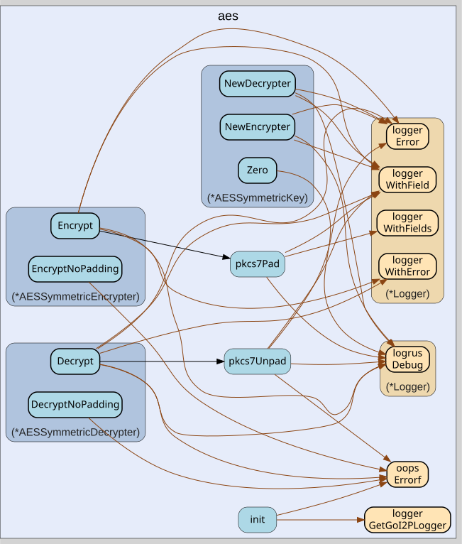

# aes
--
    import "github.com/go-i2p/crypto/aes"




## Usage

```go
var (
	// ErrInvalidKeySize indicates the AES key is not 16, 24, or 32 bytes
	ErrInvalidKeySize = oops.Errorf("invalid AES key size: must be 16, 24, or 32 bytes")

	// ErrInvalidIVSize indicates the AES IV is not 16 bytes
	ErrInvalidIVSize = oops.Errorf("invalid AES IV size: must be 16 bytes")
)
```
Error definitions for AES operations

#### func  NewCipher

```go
func NewCipher(c []byte) (cipher.Block, error)
```

#### type AESSymmetricDecrypter

```go
type AESSymmetricDecrypter struct {
	Key []byte
	IV  []byte
}
```

AESSymmetricDecrypter implements the Decrypter interface using AES

#### func (*AESSymmetricDecrypter) Decrypt

```go
func (d *AESSymmetricDecrypter) Decrypt(data []byte) ([]byte, error)
```
Decrypt decrypts data using AES-CBC without padding. The ciphertext length
must be a multiple of the 16-byte AES block size. This matches how I2P uses
AES-CBC (unpadded, over fixed-size payload regions).

#### type AESSymmetricEncrypter

```go
type AESSymmetricEncrypter struct {
	Key []byte
	IV  []byte
}
```

AESSymmetricEncrypter implements the Encrypter interface using AES

#### func (*AESSymmetricEncrypter) Encrypt

```go
func (e *AESSymmetricEncrypter) Encrypt(data []byte) ([]byte, error)
```
Encrypt encrypts data using AES-CBC without padding. The data length must be
a multiple of the 16-byte AES block size; callers are responsible for any
padding. This matches how I2P uses AES-CBC (unpadded, over fixed-size payload
regions).

#### type AESSymmetricKey

```go
type AESSymmetricKey struct {
	Key []byte // AES key (must be 16, 24, or 32 bytes for AES-128, AES-192, AES-256)
	IV  []byte // Initialization Vector (must be 16 bytes for AES)
}
```

AESSymmetricKey represents a symmetric key for AES encryption/decryption

#### func (*AESSymmetricKey) Len

```go
func (k *AESSymmetricKey) Len() int
```
Len returns the length of the key

#### func (*AESSymmetricKey) NewDecrypter

```go
func (k *AESSymmetricKey) NewDecrypter() (types.Decrypter, error)
```
NewDecrypter creates a new AESSymmetricDecrypter

#### func (*AESSymmetricKey) NewEncrypter

```go
func (k *AESSymmetricKey) NewEncrypter() (types.Encrypter, error)
```
NewEncrypter creates a new AESSymmetricEncrypter

#### func (*AESSymmetricKey) Zero

```go
func (k *AESSymmetricKey) Zero()
```
Zero implements secure memory cleanup for sensitive key material. Clears both
the AES key and IV from memory.


aes 

github.com/go-i2p/crypto/aes

[go-i2p template file](/template.md)
