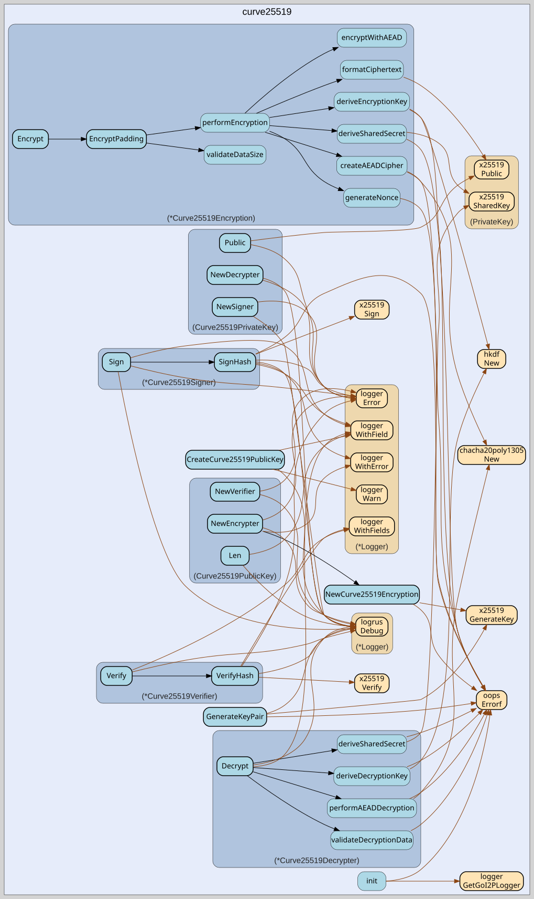

# curve25519
--
    import "github.com/go-i2p/crypto/curve25519"



Package curve25519 provides X25519 elliptic-curve encryption for I2P.

X25519 is a key-exchange algorithm built on the Curve25519 elliptic curve. Two
parties each generate a key pair, exchange their public keys, and independently
compute the same shared secret. That shared secret is then used to encrypt data
with ChaCha20-Poly1305.

# How it works

    - The sender generates a short-lived (ephemeral) key pair.
    - The sender combines its ephemeral private key with the recipient's
      public key to derive a shared secret.
    - The shared secret is stretched with HKDF into an encryption key.
    - Data is encrypted with ChaCha20-Poly1305.

The encrypted output is laid out as:

    [zero padding][ephemeral public key][nonce][ciphertext + tag]

# Relationship to the I2P ECIES specification

This package is a generic X25519 + ChaCha20-Poly1305 helper. Its wire format is
NOT the I2P ECIES-X25519-AEAD-Ratchet format described at
https://i2p.net/en/docs/specs/ecies/ : the spec's New Session / one-time message
uses an Elligator2-encoded ephemeral key, a Noise IK/"es" key schedule, a
separate authenticated flags/static section, and a counter nonce whose
associated data is the running mix-hash. Here the ephemeral key is sent raw, the
key is derived with a single plain HKDF call, the nonce is random, and there is
no associated data.

Use the ecies package for anything that must interoperate with I2P routers.

## Usage

```go
var (
	// ErrDataTooBig indicates that input data exceeds the maximum size for Curve25519 encryption.
	// The maximum allowed size is 1024 bytes to support I2P tunnel build records and protocol requirements.
	ErrDataTooBig = oops.Errorf("data too big for Curve25519 encryption")

	// ErrInvalidPublicKey indicates that a Curve25519 public key has invalid format or size.
	// The implementations in this package return this error when a public key is not
	// exactly 32 bytes; they do not validate curve-point membership (X25519 accepts any
	// 32-byte value as a public input).
	ErrInvalidPublicKey = oops.Errorf("invalid public key for Curve25519")

	// ErrInvalidPrivateKey indicates that a Curve25519 private key has invalid format or size.
	// The implementations in this package return this error when a private key is not
	// exactly 32 bytes; they do not check the scalar range (X25519 clamps the scalar
	// internally, so any 32-byte value is usable).
	ErrInvalidPrivateKey = oops.Errorf("invalid private key for Curve25519")

	// ErrInvalidSignature indicates that a Curve25519 signature verification failed.
	// This occurs when the signature doesn't match the expected format or fails cryptographic verification.
	ErrInvalidSignature = oops.Errorf("invalid signature for Curve25519")

	// ErrDecryptionFailed indicates that Curve25519 decryption operation failed.
	// This typically occurs due to corrupted ciphertext, wrong keys, or invalid data format.
	ErrDecryptionFailed = oops.Errorf("failed to decrypt data with Curve25519")
)
```
Error constants for Curve25519 cryptographic operations. These errors provide
specific failure modes for X25519 elliptic curve operations including
encryption, decryption, signing, verification, and key management.

#### func  CreateCurve25519PublicKey

```go
func CreateCurve25519PublicKey(data []byte) (k *x25519.PublicKey)
```
CreateCurve25519PublicKey creates a Curve25519 public key from raw byte data.
This function validates the input data length and constructs a proper X25519
public key. The data must be exactly 32 bytes to match the X25519 public key
size specification. Returns nil if the input data length is invalid, otherwise
returns a pointer to the created key.

Deprecated: Use NewCurve25519PublicKey instead. This function will be removed in
v2.0.

#### func  GenerateKeyPair

```go
func GenerateKeyPair() (types.PublicEncryptionKey, types.PrivateEncryptionKey, error)
```
GenerateKeyPair generates a new Curve25519 key pair for encryption/decryption
operations. Returns the public key, private key, and any error that occurred
during generation. Moved from: curve25519.go

#### func  GenerateX25519KeyPair

```go
func GenerateX25519KeyPair() (*Curve25519PublicKey, *Curve25519PrivateKey, error)
```
GenerateX25519KeyPair generates a new Curve25519 (X25519) key pair for
encryption. This is the recommended API for generating X25519 keys, returning
concrete types directly without interface conversions.

Returns:

    - *Curve25519PublicKey: The public key for encryption
    - *Curve25519PrivateKey: The private key for decryption (must be zeroed after use)
    - error: Any error that occurred during key generation

Example:

    pubKey, privKey, err := curve25519.GenerateX25519KeyPair()
    if err != nil {
        return err
    }
    defer privKey.Zero()  // Securely clear private key when done

    // Use keys directly without type assertions
    encrypter, _ := pubKey.NewEncrypter()
    ciphertext, _ := encrypter.Encrypt(plaintext)

#### func  SharedKey

```go
func SharedKey(privateKey, peerPublicKey []byte) ([]byte, error)
```
SharedKey computes a Curve25519 Diffie-Hellman shared secret. privateKey is 32
bytes (scalar), peerPublicKey is 32 bytes (point). Returns the 32-byte shared
secret or an error if inputs are invalid.

This is a convenience wrapper around x25519.PrivateKey.SharedKey and is intended
as a drop-in replacement for go.step.sm/crypto/x25519 SharedKey usage in
go-noise and similar callers:

    sharedKey, err := curve25519.SharedKey(localPrivate, remotePublic)

#### func  SharedKeyFromTyped

```go
func SharedKeyFromTyped(privateKey *Curve25519PrivateKey, peerPublicKey *Curve25519PublicKey) ([]byte, error)
```
SharedKeyFromTyped computes a Curve25519 Diffie-Hellman shared secret using the
package's typed key representations.

#### type Curve25519Decrypter

```go
type Curve25519Decrypter struct {
}
```

Curve25519Decrypter handles Curve25519-based decryption operations. This type
implements the types.Decrypter interface and provides X25519 elliptic curve
decryption using ChaCha20-Poly1305 AEAD for secure data decryption in I2P
network protocols.

#### func (*Curve25519Decrypter) Decrypt

```go
func (c *Curve25519Decrypter) Decrypt(data []byte) ([]byte, error)
```
Decrypt decrypts data that was encrypted using Curve25519 and ChaCha20-Poly1305
AEAD. The encrypted data format is: [zero
padding][ephemeral_public_key][nonce][aead_ciphertext] This method performs
X25519 key exchange with the ephemeral public key, derives the decryption key
using HKDF-SHA256, and then decrypts the data using ChaCha20-Poly1305
authenticated encryption. The minimum data size is 61 bytes (1 zero-padding byte
+ 32-byte public key + 12-byte nonce + 16-byte tag).

#### type Curve25519Encryption

```go
type Curve25519Encryption struct {
}
```

Curve25519Encryption handles Curve25519-based encryption operations. This type
provides X25519 elliptic curve encryption using ChaCha20-Poly1305 AEAD for
secure data encryption in I2P network protocols with ephemeral key exchange.

#### func  NewCurve25519Encryption

```go
func NewCurve25519Encryption(pub *x25519.PublicKey, rand io.Reader) (*Curve25519Encryption, error)
```
NewCurve25519Encryption creates a new Curve25519 encryption instance for
encrypting data. This function generates an ephemeral key pair and prepares the
encryption context for secure communication with the provided recipient public
key. The ephemeral key provides forward secrecy ensuring that encrypted data
cannot be decrypted even if long-term keys are compromised. Returns
ErrInvalidPublicKey if the public key is nil or has invalid size (must be 32
bytes).

#### func (*Curve25519Encryption) Encrypt

```go
func (c *Curve25519Encryption) Encrypt(data []byte) ([]byte, error)
```
Encrypt encrypts data using Curve25519 and ChaCha20-Poly1305 with automatic zero
padding. This method provides a simplified interface for encryption operations
with default padding enabled. The maximum data size is 1024 bytes to support I2P
tunnel build records and network protocols. Returns encrypted data in format:
[zero_padding][ephemeral_pubkey][nonce][aead_ciphertext]

#### func (*Curve25519Encryption) EncryptPadding

```go
func (c *Curve25519Encryption) EncryptPadding(data []byte, zeroPadding bool) ([]byte, error)
```
EncryptPadding encrypts data using Curve25519 and ChaCha20-Poly1305 with
optional zero padding. This method performs X25519 key exchange with the
recipient's public key, derives an encryption key using HKDF-SHA256, and
encrypts the data using ChaCha20-Poly1305 authenticated encryption. The
zeroPadding parameter controls whether to prepend a zero byte to the output
format. Maximum data size is 1024 bytes to support I2P tunnel data minus
overhead requirements.

#### type Curve25519PrivateKey

```go
type Curve25519PrivateKey []byte
```

Curve25519PrivateKey represents a Curve25519 private key for decryption and
signing operations. This type implements the types.PrivateEncryptionKey
interface and provides X25519 elliptic curve cryptographic operations including
key derivation, decryption, and digital signature creation.

CRITICAL: Always use NewCurve25519PrivateKey() to create instances.

WRONG - Unsafe:

    var key Curve25519PrivateKey  // Zero value - cryptographically invalid

CORRECT - Use constructor:

    privKey, err := curve25519.NewCurve25519PrivateKey(privBytes)
    if err != nil {
        return err
    }
    defer privKey.Zero() // Always zero private keys

Security:

    - Private keys contain sensitive material
    - Always call Zero() when done to clear memory
    - Never log or transmit private keys
    - Reject all-zero keys (cryptographically invalid)

#### func  NewCurve25519PrivateKey

```go
func NewCurve25519PrivateKey(data []byte) (*Curve25519PrivateKey, error)
```
NewCurve25519PrivateKey creates a validated Curve25519 private key from bytes.
This is the REQUIRED constructor - do not use var declarations or direct
construction.

Parameters:

    - data: Must be exactly 32 bytes (x25519.PrivateKeySize)

Returns error if data length is invalid or key is all zeros.

Example usage:

    privKey, err := curve25519.NewCurve25519PrivateKey(privBytes)
    if err != nil {
        return err
    }
    defer privKey.Zero() // Always zero private keys when done

#### func (Curve25519PrivateKey) Bytes

```go
func (k Curve25519PrivateKey) Bytes() []byte
```
Bytes returns the raw byte representation of the Curve25519 private key. The
returned slice contains the 32-byte X25519 private key material in little-endian
format. This is the Bytes() method of the types.PrivateEncryptionKey interface
for key serialization and storage operations.

#### func (Curve25519PrivateKey) NewDecrypter

```go
func (k Curve25519PrivateKey) NewDecrypter() (types.Decrypter, error)
```
NewDecrypter creates a new Curve25519 decrypter for decrypting data encrypted to
this private key. The decrypter uses X25519 elliptic curve Diffie-Hellman key
exchange combined with ChaCha20-Poly1305 AEAD decryption to provide secure
decryption of data encrypted with the corresponding public key. Returns
ErrInvalidPrivateKey if the private key size is invalid (must be 32 bytes).

#### func (Curve25519PrivateKey) NewSigner

```go
func (k Curve25519PrivateKey) NewSigner() (types.Signer, error)
```
NewSigner creates a new Curve25519 signer for creating digital signatures with
this private key. The signer uses X25519 elliptic curve digital signature
algorithms to create cryptographically secure signatures that can be verified
using the corresponding Curve25519 public key. Returns ErrInvalidPrivateKey if
the private key size is invalid (must be 32 bytes).

#### func (Curve25519PrivateKey) Public

```go
func (k Curve25519PrivateKey) Public() (types.PublicEncryptionKey, error)
```
Public derives the corresponding public key from this Curve25519 private key.
This method implements the types.PrivateEncryptionKey interface and uses X25519
scalar multiplication to compute the public key point on the curve. The
operation is mathematically equivalent to computing pubkey = privkey * basepoint
on the Curve25519 elliptic curve. Returns ErrInvalidPrivateKey if the private
key size is invalid (must be 32 bytes).

#### func (Curve25519PrivateKey) Zero

```go
func (k Curve25519PrivateKey) Zero()
```
Zero securely clears the private key material from memory. This method
implements the Zero() method of the types.PrivateEncryptionKey interface and
overwrites all bytes of the private key with zeros to prevent sensitive
cryptographic material from remaining in memory after use. This is essential for
maintaining security in cryptographic applications.

#### type Curve25519PublicKey

```go
type Curve25519PublicKey []byte
```

Curve25519PublicKey represents a Curve25519 public key for encryption and
signature verification. This type implements the types.PublicEncryptionKey
interface and provides X25519 elliptic curve cryptographic operations for I2P
network encryption and ECDH key exchange protocols.

CRITICAL: Always use NewCurve25519PublicKey() to create instances. Direct
construction produces an unvalidated (often nil/empty) key whose operations
return errors rather than working correctly.

WRONG - No validation:

    var key Curve25519PublicKey  // nil slice - NewEncrypter()/NewVerifier() return an error
    copy(key[:], data)           // no-op: copies 0 bytes into a zero-length slice (does not grow it)

CORRECT - Use constructor:

    key, err := curve25519.NewCurve25519PublicKey(data)
    if err != nil {
        return err
    }

Deprecated patterns (avoid in new code):

    x25519Key := CreateCurve25519PublicKey(data)  // Use NewCurve25519PublicKey instead

#### func  NewCurve25519PublicKey

```go
func NewCurve25519PublicKey(data []byte) (*Curve25519PublicKey, error)
```
NewCurve25519PublicKey creates a validated Curve25519 public key from bytes.
This is the REQUIRED constructor - do not use var declarations or direct
construction.

Parameters:

    - data: Must be exactly 32 bytes (x25519.PublicKeySize)

Returns error if data length is invalid.

Example usage:

    pubKey, err := curve25519.NewCurve25519PublicKey(pubBytes)
    if err != nil {
        return err
    }

#### func (Curve25519PublicKey) Bytes

```go
func (k Curve25519PublicKey) Bytes() []byte
```
Bytes returns the raw byte representation of the Curve25519 public key. The
returned slice contains the 32-byte X25519 public key material in little-endian
format suitable for cryptographic operations and network transmission.

#### func (Curve25519PublicKey) Len

```go
func (k Curve25519PublicKey) Len() int
```
Len returns the length of the Curve25519 public key in bytes. A valid X25519
public key is always 32 bytes as defined by the curve specification; a nil or
zero-value key (constructed without a constructor) returns its actual length,
which may be 0. This method is used for key validation and buffer allocation in
cryptographic operations.

#### func (Curve25519PublicKey) NewEncrypter

```go
func (k Curve25519PublicKey) NewEncrypter() (types.Encrypter, error)
```
NewEncrypter creates a new Curve25519 encrypter for encrypting data to this
public key. The encrypter uses X25519 elliptic curve Diffie-Hellman key exchange
combined with ChaCha20-Poly1305 AEAD encryption to provide secure encryption
suitable for I2P network protocols. Returns ErrInvalidPublicKey if the key size
is invalid (must be 32 bytes).

#### func (Curve25519PublicKey) NewVerifier

```go
func (k Curve25519PublicKey) NewVerifier() (types.Verifier, error)
```
NewVerifier creates a Curve25519 verifier for signature verification operations.
This method validates the public key size and returns a verifier instance
capable of verifying signatures created with the corresponding Curve25519
private key using X25519 signature algorithms. Returns ErrInvalidPublicKey if
the key size is invalid (must be 32 bytes).

#### type Curve25519Signer

```go
type Curve25519Signer struct {
}
```

Curve25519Signer handles Curve25519-based digital signature creation operations.
This type implements the types.Signer interface and provides X25519 elliptic
curve signature generation using SHA-512 hashing for data integrity and
authentication in I2P network protocols.

#### func (*Curve25519Signer) Sign

```go
func (s *Curve25519Signer) Sign(data []byte) ([]byte, error)
```
Sign creates a digital signature of the provided data using Curve25519
cryptography. This method automatically hashes the input data using SHA-512
before signing to ensure data integrity. The signature can be verified using the
corresponding Curve25519 public key and the original data. Returns
ErrInvalidPrivateKey if the private key size is invalid (must be 32 bytes).

#### func (*Curve25519Signer) SignHash

```go
func (s *Curve25519Signer) SignHash(h []byte) ([]byte, error)
```
SignHash creates a digital signature of a pre-computed hash using Curve25519
cryptography. This method accepts a pre-hashed input (typically SHA-512) and
creates a cryptographic signature using X25519 elliptic curve algorithms. This
is useful when the hash has already been computed or when implementing custom
hash functions for specific I2P protocol requirements.

#### type Curve25519Verifier

```go
type Curve25519Verifier struct {
}
```

Curve25519Verifier handles Curve25519-based digital signature verification
operations. This type implements the types.Verifier interface and provides
X25519 elliptic curve signature verification using SHA-512 hashing for
authenticating data integrity in I2P network protocols.

#### func (*Curve25519Verifier) Verify

```go
func (v *Curve25519Verifier) Verify(data, sig []byte) error
```
Verify verifies a digital signature against the provided data using Curve25519
cryptography. This method automatically hashes the input data using SHA-512
before verification to ensure data integrity. It validates that the signature
was created by the private key corresponding to this public key using the
provided data. This is the primary method for signature verification in I2P
protocols.

#### func (*Curve25519Verifier) VerifyHash

```go
func (v *Curve25519Verifier) VerifyHash(h, sig []byte) error
```
VerifyHash verifies a digital signature against a pre-computed hash using
Curve25519 cryptography. This method validates that the signature was created by
the private key corresponding to this public key using the provided hash. The
hash should typically be computed using SHA-512 for security. Returns
types.ErrBadSignatureSize for invalid signature length, ErrInvalidPublicKey for
invalid key, or ErrInvalidSignature if verification fails.


curve25519 

github.com/go-i2p/crypto/curve25519

[go-i2p template file](/template.md)
