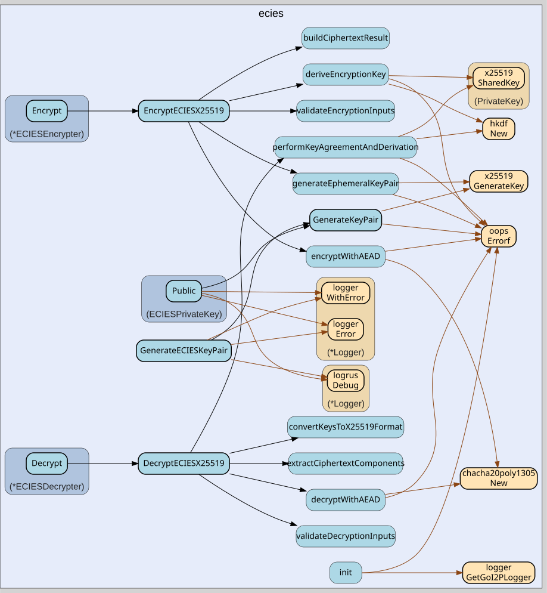

# ecies
--
    import "github.com/go-i2p/crypto/ecies"



Package ecies implements ECIES-X25519-AEAD-Ratchet, the modern end-to-end
encryption scheme for I2P.

# What this package does

I2P lets two routers talk to each other without anyone in the middle being able
to read the messages. This package is the building block that makes that
possible. It replaces the older ElGamal/AES+SessionTags scheme with a faster,
smaller, and more secure design.

The scheme is built from three well-known pieces:

    - X25519: a way for two parties to agree on a shared secret over an
      insecure channel. Each key is 32 bytes. See RFC 7748.
    - ChaCha20-Poly1305: an authenticated encryption scheme (AEAD) that both
      hides the message and proves it was not tampered with. See RFC 8439.
    - A ratchet: a one-way chain of keys that gives forward secrecy, meaning
      that compromising one key does not reveal past messages.

# How it fits the I2P specification

This package implements the core primitives of the I2P ECIES-X25519-AEAD scheme
(Proposal 144), which is supported by I2P routers as of version 0.9.46. In the
network's LeaseSet2 (LS2) records, this scheme is identified by crypto type 4,
which marks a 32-byte little-endian X25519 public key. (Crypto type 0 is the
legacy ElGamal scheme; types 1-3 are reserved for a different ECIES variant.)

The one-shot EncryptECIESX25519/DecryptECIESX25519 functions implement the
spec's one-time (IK) pattern: the ephemeral key is Elligator2-encoded
for the wire, the key is derived with the spec's Noise-based chain, and the
ciphertext uses the spec's two-section layout. See the "The two main operations"
section below for the wire format.

One thing to know before using them on real traffic: these functions encrypt and
decrypt opaque byte buffers. Section 1d requires the one-time *payload* to
contain a DateTime block and usually Garlic Clove blocks, and section 5 defines
that block format (1-byte type, 2-byte big-endian length) and its ordering
rules. This package does not build, parse or validate payload blocks, so a
caller composing an I2P message must format the payload itself.

# Specification coverage

Implemented: the one-time format and its key schedule (sections 1d and the
no-static-key path of 1f), the Elligator2 encoding of section 2a, and the AEAD
rules of section 3.

Not implemented: the New Session message with a static key (sections 1a and
1b), the New Session Reply (section 1g) and its SessionReplyTags KDF, the
Existing Session message framing of section 1h (the ratchet package supplies the
session tag, per-message key and nonce that 1h requires, but no message
framing), and the payload block format of section 5. The scheme is therefore not
a complete replacement for ElGamal/AES+SessionTags on its own; see the ratchet
package docs for the data-phase gaps.

See the official specification for the full protocol:
https://i2p.net/en/docs/specs/ecies/

# The two main operations

EncryptECIESX25519 and DecryptECIESX25519 implement a one-shot ephemeral-static
exchange: the sender generates a fresh ephemeral key, agrees a shared secret
with the recipient's static key, and encrypts with ChaCha20-Poly1305.

The ciphertext follows the spec's one-time format (section 1d). It has three
parts:

    - An Elligator2-encoded ephemeral public key (32 bytes).
    - A flags section: 32 bytes of ChaCha20 ciphertext plus a 16-byte
      Poly1305 tag (48 bytes). The decrypted flags are 32 bytes of zeros.
    - A payload section: the ChaCha20 ciphertext of the message plus a
      16-byte Poly1305 tag.

The total overhead is 96 bytes. The two sections are authenticated separately,
so a tampered flags section is rejected without decrypting the payload. The key
is derived with the spec's Noise "IK" + "es" + "N" schedule (section 1f), not a
single HKDF call.

For long-lived sessions that need forward secrecy, see [ratchet.Session], which
layers the three ratchets (session tag, symmetric key, and DH ratchet) on top of
the same primitives and implements the spec's data-phase KDFs exactly, including
the mandatory Noise Split() that keeps the inbound and outbound chains
independent. Note that a Session created here is still not a complete data
phase: the New Session Reply handshake that seeds it, and the payload block
format, are not implemented. This
package previously exposed a SessionState convenience type whose static-static
initial key derivation used non-spec KDF parameters; it was not a spec-mandated
wire format and has been removed. Use [ratchet.Session] for ratcheted sessions.

# Key sizes

    - Public and private keys: 32 bytes (X25519)
    - Nonce: 12 bytes (ChaCha20-Poly1305)
    - Authentication tag: 16 bytes (Poly1305)
    - Maximum plaintext: 65519 bytes (spec section 5: a 65535-byte ChaChaPoly
      frame minus the 16-byte Poly1305 tag)

## Usage

```go
const (
	// PublicKeySize is the size of X25519 public keys in bytes
	PublicKeySize = 32
	// PrivateKeySize is the size of X25519 private keys in bytes
	PrivateKeySize = 32
	// NonceSize is the size of ChaCha20-Poly1305 nonces in bytes
	NonceSize = 12
	// TagSize is the size of Poly1305 authentication tags in bytes
	TagSize = 16
	// MaxPlaintextSize is the maximum size of plaintext data for encryption.
	// Per the I2P ECIES spec section 5, an encrypted ChaChaPoly frame is at most
	// 65535 bytes including the 16-byte Poly1305 tag, so the largest plaintext
	// is 65519 bytes.
	MaxPlaintextSize = 65519
)
```
Constants for ECIES-X25519 implementation Moved from: ecies.go

```go
var (
	ErrInvalidPublicKey           = oops.Errorf("invalid public key for ECIES-X25519")
	ErrInvalidPrivateKey          = oops.Errorf("invalid private key for ECIES-X25519")
	ErrDataTooBig                 = oops.Errorf("data too large for ECIES-X25519 encryption")
	ErrInvalidCiphertext          = oops.Errorf("invalid ciphertext for ECIES-X25519 decryption")
	ErrDecryptionFailed           = oops.Errorf("ECIES-X25519 decryption failed")
	ErrKeyDerivationFailed        = oops.Errorf("ECIES-X25519 key derivation failed")
	ErrNotElligator2Representable = oops.Errorf("public key is not Elligator2-representable")
	ErrKeyGenerationFailed        = oops.Errorf("ECIES-X25519 key generation failed")
	ErrEncryptionFailed           = oops.Errorf("ECIES-X25519 encryption failed")
)
```
Error constants for ECIES operations Moved from: ecies.go

#### func  DecryptECIESX25519

```go
func DecryptECIESX25519(recipientPrivKey, ciphertext []byte) ([]byte, error)
```
DecryptECIESX25519 decrypts data using the I2P ECIES-X25519-AEAD one-time format
produced by EncryptECIESX25519.

Parameters:

    - recipientPrivKey: The recipient's 32-byte X25519 private key (Bob's static key)
    - ciphertext: The encrypted data in the one-time format

Returns:

    - plaintext: The decrypted data
    - error: Any error during decryption

#### func  DeriveMessageKey

```go
func DeriveMessageKey(chainKey []byte, messageNumber uint32) ([32]byte, error)
```
DeriveMessageKey derives the message encryption key at position messageNumber of
the symmetric key ratchet chain that starts at chainKey.

Per the I2P ECIES spec (section 4c), the chain key must be ratcheted
messageNumber times before deriving:

    keydata_n = HKDF(symmKey_chainKey_(n-1), SYMMKEY_CONSTANT, "SymmetricRatchet", 64)
    k_n       = keydata_n[32:64]

The message number is therefore *not* mixed into the KDF itself; it selects how
far along the one-way chain the caller walks. Deriving without advancing would
return k_0 for every n, handing different messages the same key.

chainKey: The current chain key (32 bytes) messageNumber: The message sequence
number for this key Returns (messageKey, error)

#### func  DeriveSessionTag

```go
func DeriveSessionTag(chainKey []byte, tagNumber uint32) ([8]byte, error)
```
DeriveSessionTag derives the session tag at position tagNumber of a tag set.

chainKey is the session tag chain key seed (sessTag_ck) — the value the DH
ratchet outputs before the tag set is initialized. It is NOT an already advanced
live chain key: this function runs the spec's STInitialization KDF on it (via
[ratchet.NewTagRatchet]) to obtain the first chain key, then steps the ratchet
to tagNumber. Passing a chain key that has already been through STInitialization
would initialize the ratchet a second time and yield tags that do not match the
session's.

tagNumber: The tag sequence number (0 produces tag_0) Returns (tag, error) where
tag is 8 bytes

#### func  EncryptECIESX25519

```go
func EncryptECIESX25519(recipientPubKey, plaintext []byte) ([]byte, error)
```
EncryptECIESX25519 encrypts data using the I2P ECIES-X25519-AEAD one-time
format.

The ciphertext layout (spec section 1d) is:

    [Elligator2-encoded ephemeral public key 32 bytes]
    [flags section: ChaCha20 ciphertext 32 bytes + Poly1305 tag 16 bytes]
    [payload section: ChaCha20 ciphertext N bytes + Poly1305 tag 16 bytes]

The key schedule follows the Noise "IK" + "es" + "N" patterns (spec section 1f):

    protocol_name = "Noise_IKelg2+hs2_25519_ChaChaPoly_SHA256"
    h = SHA256(protocol_name)
    chainKey = h
    h = SHA256(h)                       // MixHash with empty prologue
    h = SHA256(h || bpk)                // MixHash with Bob's static public key
    h = SHA256(h || aepk)               // MixHash with Alice's ephemeral public key
    sharedSecret = DH(aesk, bpk)
    keydata = HKDF(salt=chainKey, ikm=sharedSecret, info="", 64)
    k = keydata[32:64]

The flags section encrypts 32 bytes of all zeros with nonce 0 and associated
data h; the payload is then encrypted with nonce 1 and the updated h. Both
sections use the same key k.

Parameters:

    - recipientPubKey: The recipient's 32-byte X25519 public key (Bob's static key)
    - plaintext: The data to encrypt

Returns:

    - ciphertext: The encrypted data in the one-time format
    - error: Any error during encryption

#### func  GenerateECIESKeyPair

```go
func GenerateECIESKeyPair() (*ECIESPublicKey, *ECIESPrivateKey, error)
```
GenerateECIESKeyPair generates a new ECIES key pair using the standard interface
types

#### func  GenerateKeyPair

```go
func GenerateKeyPair() ([]byte, []byte, error)
```
GenerateKeyPair generates a new X25519 key pair suitable for ECIES-X25519.
Returns (publicKey, privateKey, error) where keys are 32 bytes each.

#### type ECIESDecrypter

```go
type ECIESDecrypter struct {
	PrivateKey ECIESPrivateKey
}
```

ECIESDecrypter implements types.Decrypter using ECIES

#### func (*ECIESDecrypter) Decrypt

```go
func (d *ECIESDecrypter) Decrypt(data []byte) ([]byte, error)
```
Decrypt decrypts data using ECIES-X25519

#### type ECIESEncrypter

```go
type ECIESEncrypter struct {
	PublicKey ECIESPublicKey
}
```

ECIESEncrypter implements types.Encrypter using ECIES

#### func (*ECIESEncrypter) Encrypt

```go
func (e *ECIESEncrypter) Encrypt(data []byte) ([]byte, error)
```
Encrypt encrypts data using ECIES-X25519

#### type ECIESPrivateKey

```go
type ECIESPrivateKey [PrivateKeySize]byte
```

ECIESPrivateKey represents an ECIES X25519 private key for decryption

#### func (ECIESPrivateKey) Bytes

```go
func (k ECIESPrivateKey) Bytes() []byte
```
Bytes returns the private key as a byte slice

#### func (ECIESPrivateKey) Len

```go
func (k ECIESPrivateKey) Len() int
```
Len returns the length of the private key in bytes

#### func (ECIESPrivateKey) NewDecrypter

```go
func (k ECIESPrivateKey) NewDecrypter() (types.Decrypter, error)
```
NewDecrypter creates a new decrypter using this private key

#### func (ECIESPrivateKey) Public

```go
func (k ECIESPrivateKey) Public() (types.PublicEncryptionKey, error)
```
Public returns the corresponding public key derived from this private key. This
uses X25519 scalar base multiplication to properly derive the public key.

#### func (*ECIESPrivateKey) Zero

```go
func (k *ECIESPrivateKey) Zero()
```
Zero securely clears the private key from memory.

The receiver is a pointer so the caller's key material is actually cleared:
ECIESPrivateKey is a fixed-size array, and a value receiver would only zero a
copy, leaving the original key in memory.

#### type ECIESPublicKey

```go
type ECIESPublicKey [PublicKeySize]byte
```

ECIESPublicKey represents an ECIES X25519 public key for encryption

#### func (ECIESPublicKey) Bytes

```go
func (k ECIESPublicKey) Bytes() []byte
```
Bytes returns the public key as a byte slice

#### func (ECIESPublicKey) Len

```go
func (k ECIESPublicKey) Len() int
```
Len returns the length of the public key in bytes

#### func (ECIESPublicKey) NewEncrypter

```go
func (k ECIESPublicKey) NewEncrypter() (types.Encrypter, error)
```
NewEncrypter creates a new encrypter using this public key


ecies 

github.com/go-i2p/crypto/ecies

[go-i2p template file](/template.md)
