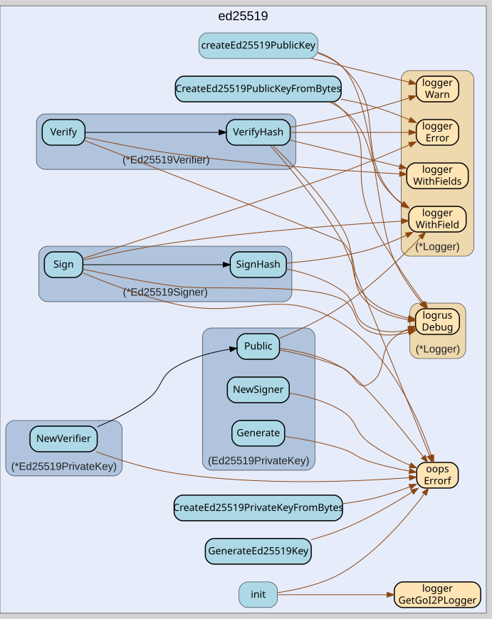

# ed25519
--
    import "github.com/go-i2p/crypto/ed25519"



Package ed25519 provides Ed25519 digital signatures for I2P.

Ed25519 is a modern signature algorithm. It produces small signatures, verifies
quickly, and is resistant to many of the mistakes that make older signature
schemes unsafe. It is defined in RFC 8032 and is the standard signature type for
I2P destinations.

# How it works

    - The signer uses its private key to create a 64-byte signature.
    - A verifier checks the signature against the signer's public key.

Note: Ed25519 is for signatures only. Use the curve25519 package for encryption.

See RFC 8032 for the Ed25519 specification:
https://datatracker.ietf.org/doc/html/rfc8032

## Usage

```go
var (
	// ErrInvalidPublicKey indicates the public key is not a valid Ed25519 point
	ErrInvalidPublicKey = oops.Errorf("invalid Ed25519 public key encoding")

	// ErrInvalidScalar indicates the blinding factor is not a valid scalar
	ErrInvalidScalar = oops.Errorf("invalid blinding factor scalar")

	// ErrIdentityPoint indicates the result would be the identity point
	ErrIdentityPoint = oops.Errorf("result is identity point")

	// ErrInvalidPrivateKey indicates the private key is not valid
	ErrInvalidPrivateKey = oops.Errorf("invalid Ed25519 private key")
)
```

```go
var (
	ErrInvalidPublicKeySize = oops.Errorf("failed to verify: invalid ed25519 public key size")
)
```
ErrInvalidPublicKeySize indicates an Ed25519 public key does not meet the
required 32-byte size. Error constants for Ed25519 operations Moved from:
ed25519.go

#### func  BlindPrivateKey

```go
func BlindPrivateKey(privateKey [64]byte, alpha [32]byte) ([64]byte, error)
```
BlindPrivateKey blinds an Ed25519 private key using a blinding factor (alpha).
The blinded private key can sign on behalf of the blinded public key.

The blinding operation applies: d' = d + alpha (mod L) where:

    - d is the original private scalar (derived from the private key seed)
    - alpha is the 32-byte blinding factor
    - L is the Ed25519 group order
    - d' is the resulting blinded private scalar

The returned blinded private key is a 64-byte value with the format:

    - [32 bytes: blinded scalar d']
    - [32 bytes: blinded public key P']

IMPORTANT: The returned key cannot be used directly with crypto/ed25519.Sign()
because Go's ed25519 expects [seed][pubkey] format, not [scalar][pubkey]. To
sign with a blinded key, you must use the scalar directly with edwards25519:

    scalar, _ := (&edwards25519.Scalar{}).SetCanonicalBytes(blindedPriv[:32])
    // Use scalar for signing with edwards25519 API

Parameters:

    - privateKey: 64-byte Ed25519 private key to blind
    - alpha: 32-byte blinding factor (same alpha used for BlindPublicKey)

Returns:

    - Blinded 64-byte value [scalar][pubkey]
    - Error if private key is invalid or alpha is invalid

Example:

    // Blind both private and public keys with the same spec-conformant alpha
    alpha, _ := kdf.DeriveBlindingFactorI2P(pubKey[:], "", kdf.SigTypeEdDSASha512Ed25519, time.Now())
    blindedPriv, _ := ed25519.BlindPrivateKey(privKey, alpha)
    blindedPub, _ := ed25519.BlindPublicKey(pubKey, alpha)

    // Extract scalar for signing (requires edwards25519 library)
    scalar, _ := (&edwards25519.Scalar{}).SetCanonicalBytes(blindedPriv[:32])

Spec: I2P Proposal 123 - Encrypted LeaseSet

#### func  BlindPublicKey

```go
func BlindPublicKey(publicKey, alpha [32]byte) ([32]byte, error)
```
BlindPublicKey blinds an Ed25519 public key using a blinding factor (alpha).
This is used to create unlinkable blinded destinations for EncryptedLeaseSet.

The blinding operation applies: P' = P + [alpha]B where:

    - P is the original public key point
    - alpha is the 32-byte blinding factor
    - B is the Ed25519 base point
    - P' is the resulting blinded public key

This operation is used in I2P's EncryptedLeaseSet to create per-day blinded
destinations that cannot be linked to the original destination without knowing
alpha.

Parameters:

    - publicKey: 32-byte Ed25519 public key to blind
    - alpha: 32-byte blinding factor (typically from kdf.DeriveBlindingFactorI2P)

Returns:

    - Blinded 32-byte public key
    - Error if public key is invalid, alpha is invalid, or result is identity

Example:

    // Derive the spec-conformant blinding factor for today
    alpha, err := kdf.DeriveBlindingFactorI2P(pubKey[:], "", kdf.SigTypeEdDSASha512Ed25519, time.Now())
    if err != nil {
        return err
    }

    // Blind the public key
    blindedPubKey, err := ed25519.BlindPublicKey(pubKey, alpha)
    if err != nil {
        return err
    }

Spec: I2P Proposal 123 - Encrypted LeaseSet Reference:
https://ed25519.cr.yp.to/papers.html

#### func  GenerateEd25519Key

```go
func GenerateEd25519Key() (types.SigningPrivateKey, error)
```
GenerateEd25519Key generates a new Ed25519 private key for digital signatures.
This function creates a cryptographically secure Ed25519 keypair using the
system's random number generator. The returned private key implements the
SigningPrivateKey interface. Example usage: privKey, err := GenerateEd25519Key()
GenerateEd25519Key generates a new Ed25519 private key for digital signatures.
Returns a private key that implements the SigningPrivateKey interface. Moved
from: ed25519.go

#### func  GenerateEd25519KeyPair

```go
func GenerateEd25519KeyPair() (*Ed25519PublicKey, *Ed25519PrivateKey, error)
```
GenerateEd25519KeyPair generates a new Ed25519 key pair for digital signatures.
This is the recommended API for generating Ed25519 keys, returning concrete
types directly without interface conversions.

Returns:

    - *Ed25519PublicKey: The public key for signature verification
    - *Ed25519PrivateKey: The private key for signing (must be zeroed after use)
    - error: Any error that occurred during key generation

Example:

    pubKey, privKey, err := ed25519.GenerateEd25519KeyPair()
    if err != nil {
        return err
    }
    defer privKey.Zero()  // Securely clear private key when done

    // Use keys directly without type assertions
    signer, _ := privKey.NewSigner()
    signature, _ := signer.Sign(data)

#### func  UnblindPublicKey

```go
func UnblindPublicKey(blindedPublicKey, alpha [32]byte) ([32]byte, error)
```
UnblindPublicKey reverses the blinding operation on a public key. This is useful
for verification: given P' and alpha, recover P.

The operation applies: P = P' - [alpha]B where:

    - P' is the blinded public key
    - alpha is the blinding factor used to create P'
    - B is the Ed25519 base point
    - P is the original public key

This is primarily used for testing and verification. In normal operation,
clients derive blinded keys independently rather than unblinding them.

Parameters:

    - blindedPublicKey: 32-byte blinded Ed25519 public key
    - alpha: 32-byte blinding factor that was used to blind the key

Returns:

    - Original unblinded 32-byte public key
    - Error if inputs are invalid or result is identity

Example:

    // Verify blinding/unblinding round-trip
    alpha, _ := kdf.DeriveBlindingFactorI2P(original[:], "", kdf.SigTypeEdDSASha512Ed25519, time.Now())
    blinded, _ := ed25519.BlindPublicKey(original, alpha)
    recovered, _ := ed25519.UnblindPublicKey(blinded, alpha)
    // recovered should equal original

#### type Ed25519PrivateKey

```go
type Ed25519PrivateKey ed25519.PrivateKey
```

Ed25519PrivateKey represents an Ed25519 private key for digital signature
operations. This key type implements the SigningPrivateKey interface and
provides methods for signing data and generating verifiers. Ed25519 keys are 64
bytes in length.

CRITICAL: Always use NewEd25519PrivateKey() to create instances.

WRONG - Unsafe:

    var key Ed25519PrivateKey  // Zero value - cryptographically invalid

CORRECT - Use constructor:

    privKey, err := ed25519.NewEd25519PrivateKey(privBytes)
    if err != nil {
        return err
    }
    defer privKey.Zero() // Always zero private keys

Security:

    - Private keys contain sensitive material
    - Always call Zero() when done to clear memory
    - Never log or transmit private keys

#### func  CreateEd25519PrivateKeyFromBytes

```go
func CreateEd25519PrivateKeyFromBytes(data []byte) (Ed25519PrivateKey, error)
```
CreateEd25519PrivateKeyFromBytes constructs an Ed25519 private key from raw byte
data. The input data must be exactly 64 bytes representing a valid Ed25519
private key. Returns an error if the data length is incorrect or the key format
is invalid.

Deprecated: Use [NewEd25519PrivateKey] instead, which performs identical
validation and copying. This function will be removed in v2.0.

#### func  NewEd25519PrivateKey

```go
func NewEd25519PrivateKey(data []byte) (Ed25519PrivateKey, error)
```
NewEd25519PrivateKey creates a validated Ed25519 private key from bytes. This is
the REQUIRED constructor - do not use var declarations or direct construction.

Parameters:

    - data: Must be exactly 64 bytes

Returns error if data length is invalid.

Example usage:

    privKey, err := ed25519.NewEd25519PrivateKey(privBytes)
    if err != nil {
        return err
    }
    defer privKey.Zero() // Always zero private keys when done

#### func (Ed25519PrivateKey) Bytes

```go
func (k Ed25519PrivateKey) Bytes() []byte
```
Bytes returns the raw byte representation of the Ed25519 private key. The
returned slice contains the full 64-byte Ed25519 private key including the
embedded public key portion. This method is used for serialization.

#### func (Ed25519PrivateKey) Generate

```go
func (k Ed25519PrivateKey) Generate() (types.SigningPrivateKey, error)
```
Generate creates a new random Ed25519 private key using secure random
generation. This method generates a fresh keypair and returns it as a
SigningPrivateKey interface. The generated key is cryptographically secure and
suitable for production use.

#### func (Ed25519PrivateKey) Len

```go
func (k Ed25519PrivateKey) Len() int
```
Len returns the length of the Ed25519 private key in bytes. Ed25519 private keys
are always 64 bytes long, containing both private and public key material as
specified in RFC 8032.

#### func (Ed25519PrivateKey) NewSigner

```go
func (k Ed25519PrivateKey) NewSigner() (types.Signer, error)
```
NewSigner creates a new signer instance for generating Ed25519 digital
signatures. Returns a signer that can sign arbitrary data using this private
key. The signer automatically handles hash computation before signing.

#### func (*Ed25519PrivateKey) NewVerifier

```go
func (k *Ed25519PrivateKey) NewVerifier() (types.Verifier, error)
```
NewVerifier creates a verifier instance from this private key's public
component. This method extracts the public key and returns a verifier that can
validate signatures created by this private key. Returns an error if the private
key size is invalid. This is a convenience on the private key; the underlying
NewVerifier method that satisfies types.SigningPublicKey lives on
Ed25519PublicKey.

#### func (Ed25519PrivateKey) Public

```go
func (k Ed25519PrivateKey) Public() (types.SigningPublicKey, error)
```
Public extracts the Ed25519 public key from this private key. Returns the
corresponding public key that can be used for signature verification. The public
key is derived from the private key's embedded public component.

#### func (Ed25519PrivateKey) Zero

```go
func (k Ed25519PrivateKey) Zero()
```
Zero securely clears the private key material from memory. This method
overwrites all bytes of the private key with zeros to prevent potential memory
disclosure attacks. Should be called when the key is no longer needed.

#### type Ed25519PublicKey

```go
type Ed25519PublicKey []byte
```

Ed25519PublicKey represents an Ed25519 public key for signature verification
operations. This key type implements the SigningPublicKey interface and is used
to verify digital signatures created by corresponding Ed25519 private keys.
Public keys are 32 bytes in length.

CRITICAL: Always use NewEd25519PublicKey() to create instances. Direct
construction produces an unvalidated (often nil/empty) key whose operations
return errors rather than working correctly.

WRONG - No validation:

    var key Ed25519PublicKey  // nil slice - Bytes() returns empty; Verify returns an error
    copy(key[:], data)        // no-op: copies 0 bytes into a zero-length slice (does not grow it)

CORRECT - Use constructor:

    key, err := ed25519.NewEd25519PublicKey(data)
    if err != nil {
        return err
    }

Deprecated direct construction patterns (avoid in new code):

    key, err := CreateEd25519PublicKeyFromBytes(data)  // Use NewEd25519PublicKey instead
    key := make(Ed25519PublicKey, 32)                 // Unsafe, no validation
    key := Ed25519PublicKey(data)                      // Unsafe, no validation

#### func  CreateEd25519PublicKeyFromBytes

```go
func CreateEd25519PublicKeyFromBytes(data []byte) (Ed25519PublicKey, error)
```
CreateEd25519PublicKeyFromBytes constructs an Ed25519 public key from raw byte
data. The input data must be exactly 32 bytes representing a valid Ed25519
public key. Returns an error if the data length doesn't match the required
Ed25519 public key size.

Deprecated: Use [NewEd25519PublicKey] instead, which performs the identical
validation. This function will be removed in v2.0.

#### func  NewEd25519PublicKey

```go
func NewEd25519PublicKey(data []byte) (Ed25519PublicKey, error)
```
NewEd25519PublicKey creates a validated Ed25519 public key from bytes. This is
the REQUIRED constructor - do not use var declarations or direct construction.

Parameters:

    - data: Must be exactly 32 bytes

Returns error if data length is invalid.

Example usage:

    pubKey, err := ed25519.NewEd25519PublicKey(pubBytes)
    if err != nil {
        return err
    }

#### func (Ed25519PublicKey) Bytes

```go
func (k Ed25519PublicKey) Bytes() []byte
```
Bytes returns the raw byte representation of the Ed25519 public key. The
returned slice contains the 32-byte public key data suitable for serialization,
transmission, or storage operations.

#### func (Ed25519PublicKey) Len

```go
func (k Ed25519PublicKey) Len() int
```
Len returns the length of the Ed25519 public key in bytes. Ed25519 public keys
are always 32 bytes long as specified in RFC 8032. This method is useful for
validation and serialization operations.

#### func (Ed25519PublicKey) NewVerifier

```go
func (k Ed25519PublicKey) NewVerifier() (v types.Verifier, err error)
```
NewVerifier creates a verifier instance that can validate Ed25519 signatures.
Returns a verifier configured with this public key for signature verification
operations. The verifier can validate signatures created by the corresponding
private key.

#### type Ed25519Signer

```go
type Ed25519Signer struct {
}
```

Ed25519Signer provides digital signature creation using Ed25519 private keys.
This type implements the Signer interface for generating cryptographic
signatures over arbitrary data using the Ed25519 signature algorithm from RFC
8032.

#### func (*Ed25519Signer) Sign

```go
func (s *Ed25519Signer) Sign(data []byte) (sig []byte, err error)
```
Sign creates an Ed25519 digital signature over the provided data. The data is
passed directly to ed25519.Sign which implements PureEdDSA (RFC 8032) and
performs its own internal SHA-512 hashing. Returns the signature bytes or an
error if signing fails.

#### func (*Ed25519Signer) SignHash

```go
func (s *Ed25519Signer) SignHash(h []byte) (sig []byte, err error)
```
SignHash creates an Ed25519 signature over the provided bytes. Ed25519 is a
PureEdDSA scheme (RFC 8032): the input is treated as the message and is NOT
assumed to be a digest. Signing a pre-computed hash here produces a signature
over those hash bytes as the message, which is not equivalent to signing the
original data and is not Ed25519ph. Use [Ed25519Signer.Sign] (an alias with
identical behavior) for normal message signing.

#### type Ed25519Verifier

```go
type Ed25519Verifier struct {
}
```

Ed25519Verifier provides digital signature verification using Ed25519 public
keys. This type implements the Verifier interface for validating cryptographic
signatures created by Ed25519 private keys against the corresponding public key.

#### func (*Ed25519Verifier) Verify

```go
func (v *Ed25519Verifier) Verify(data, sig []byte) (err error)
```
Verify validates an Ed25519 signature against arbitrary data. The data is passed
directly to ed25519.Verify which implements PureEdDSA (RFC 8032) and performs
its own internal SHA-512 hashing. Returns an error if verification fails.

#### func (*Ed25519Verifier) VerifyHash

```go
func (v *Ed25519Verifier) VerifyHash(h, sig []byte) (err error)
```
VerifyHash validates an Ed25519 signature against the provided bytes. Ed25519 is
a PureEdDSA scheme (RFC 8032), so h is treated as the message and is NOT assumed
to be a digest; no additional hashing is performed. A signature produced by
[Ed25519Signer.SignHash] verifies here, and one produced by [Ed25519Signer.Sign]
verifies with [Ed25519Verifier.Verify]. Returns an error if verification fails
or inputs are invalid.


ed25519 

github.com/go-i2p/crypto/ed25519

[go-i2p template file](/template.md)
