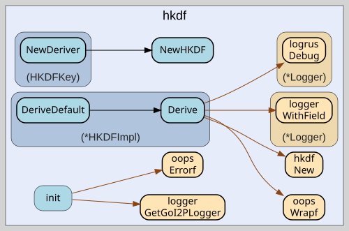

# hkdf
--
    import "github.com/go-i2p/crypto/hkdf"



Package hkdf provides key derivation using the HKDF (HMAC-based Key Derivation
Function) algorithm.

HKDF turns a shared secret (input key material) into one or more strong keys. It
is the standard way to stretch a short shared secret into encryption keys of the
exact length you need. HKDF is defined in RFC 5869 and is used throughout I2P,
including the ECIES-X25519-AEAD-Ratchet scheme.

# How it works

HKDF follows RFC 5869 and has two steps:

    1. Extract: distill the input key material into a pseudorandom key.
    2. Expand: stretch that key to the desired length.

Both steps take an "info" context string that binds the derived key to a
specific purpose, so keys for different jobs never collide.

See RFC 5869 for the HKDF specification:
https://datatracker.ietf.org/doc/html/rfc5869

## Usage

```go
const (
	// DefaultKeyLength specifies the default derived key length for I2P operations.
	// Set to 32 bytes (256 bits) to provide optimal security for ChaCha20 symmetric encryption
	// and other I2P cryptographic primitives that require 256-bit keys.
	DefaultKeyLength = 32 // 256 bits for ChaCha20

	// MaxInfoLength defines the maximum allowed length for HKDF info parameter.
	// Set to 255 bytes by this implementation as a defensive bound. RFC 5869 does not
	// limit the length of info (it only caps the output length L at 255 * HashLen
	// bytes), so this is a local restriction rather than a spec requirement.
	MaxInfoLength = 255 // Maximum info length for HKDF
)
```
Default parameters for I2P compatibility

```go
var (
	// ErrInvalidKeyLength indicates that the requested key derivation length is
	// invalid. This error is returned when the key length parameter is zero or
	// negative. An over-long request (beyond 255 * hash_length per RFC 5869) is
	// not caught here; it surfaces later as ErrKeyDerivationFailed.
	ErrInvalidKeyLength = oops.Errorf("invalid key length")

	// ErrInvalidSaltLength indicates that the provided salt parameter has an
	// invalid length. It is reserved and is not currently returned by this
	// package: HKDF accepts any salt length, including empty.
	ErrInvalidSaltLength = oops.Errorf("invalid salt length")

	// ErrInvalidInfoLength indicates that the info parameter exceeds maximum allowed length.
	// This package limits the info parameter to 255 bytes as an implementation-defined
	// safety bound; RFC 5869 itself places no length limit on info.
	ErrInvalidInfoLength = oops.Errorf("invalid info length")

	// ErrKeyDerivationFailed indicates that the HKDF key derivation process failed.
	// This error wraps underlying failures in the HKDF-Extract or HKDF-Expand phases,
	// typically due to insufficient entropy or implementation errors.
	ErrKeyDerivationFailed = oops.Errorf("key derivation failed")
)
```
Common HKDF errors

#### func  NewHKDF

```go
func NewHKDF() types.KeyDeriver
```
NewHKDF creates a new HKDF key deriver using SHA-256 hash function. This is the
recommended constructor for most use cases.

SHA-256 is selected as the default hash function because:

    - Provides 256-bit security level suitable for most applications
    - Well-tested and widely deployed in I2P protocol
    - Optimal balance between security and performance

Returns a types.KeyDeriver that implements RFC 5869 HKDF for secure key
expansion with default parameters optimized for I2P cryptographic operations.

Example usage:

    deriver := hkdf.NewHKDF()
    key, err := deriver.Derive(ikm, salt, info, 32)
    if err != nil {
        return err
    }

#### func  NewHKDFWithHash

```go
func NewHKDFWithHash(hashFunc func() hash.Hash) types.KeyDeriver
```
NewHKDFWithHash creates a new HKDF key deriver with a custom hash function.

This constructor allows specification of alternative hash algorithms for
specialized cryptographic requirements while maintaining RFC 5869 compliance.

Parameters:

    - hashFunc: Hash function constructor (e.g., sha256.New, sha512.New)

Panics if hashFunc is nil. Use NewHKDF() for the default SHA-256 hash function.

Example usage:

    // For SHA-512 based key derivation:
    deriver := hkdf.NewHKDFWithHash(sha512.New)

    // For SHA-384:
    deriver := hkdf.NewHKDFWithHash(sha512.New384)

#### type HKDFImpl

```go
type HKDFImpl struct {
}
```

HKDFImpl provides the concrete implementation of HKDF key derivation using
SHA-256. This structure encapsulates the hash function and implements the
types.KeyDeriver interface for extracting and expanding cryptographic keys
according to RFC 5869 specification.

⚠️ CRITICAL SECURITY WARNING: Do NOT construct HKDFImpl directly using var or
struct literals. Zero-value construction with nil hashFunc will default to
SHA-256, but this implicit behavior should not be relied upon. Always use
constructors for explicit configuration.

WRONG - Implicit behavior:

    var deriver HKDFImpl              // hashFunc is nil - relies on fallback
    deriver := HKDFImpl{}             // hashFunc is nil - relies on fallback

CORRECT - Use constructors:

    // For SHA-256 (recommended default):
    deriver := hkdf.NewHKDF()

    // For custom hash function:
    deriver := hkdf.NewHKDFWithHash(sha512.New)

#### func (*HKDFImpl) Derive

```go
func (h *HKDFImpl) Derive(ikm, salt, info []byte, keyLen int) ([]byte, error)
```
Derive derives a key of the specified length from the input key material (IKM).
Parameters: ikm (input key material), salt (optional random value), info
(context data), keyLen (output length). Returns derived key bytes or error if
derivation fails due to invalid parameters.

#### func (*HKDFImpl) DeriveDefault

```go
func (h *HKDFImpl) DeriveDefault(ikm []byte) ([]byte, error)
```
DeriveDefault provides convenient HKDF key derivation with I2P standard
parameters. Derives a 32-byte key from input key material using no salt and no
contextual info. Optimized for I2P applications requiring ChaCha20-compatible
256-bit keys. DeriveDefault derives a key using default parameters (32 bytes, no
salt, no info)

#### type HKDFKey

```go
type HKDFKey struct{}
```

HKDFKey provides a standard entry point for HKDF key derivation operations. This
type implements the I2P cryptographic interface pattern, allowing creation of
key derivers that follow RFC 5869 HKDF specification for secure key expansion.

#### func (HKDFKey) NewDeriver

```go
func (k HKDFKey) NewDeriver() types.KeyDeriver
```
NewDeriver returns a types.KeyDeriver for HKDF


hkdf 

github.com/go-i2p/crypto/hkdf

[go-i2p template file](/template.md)
