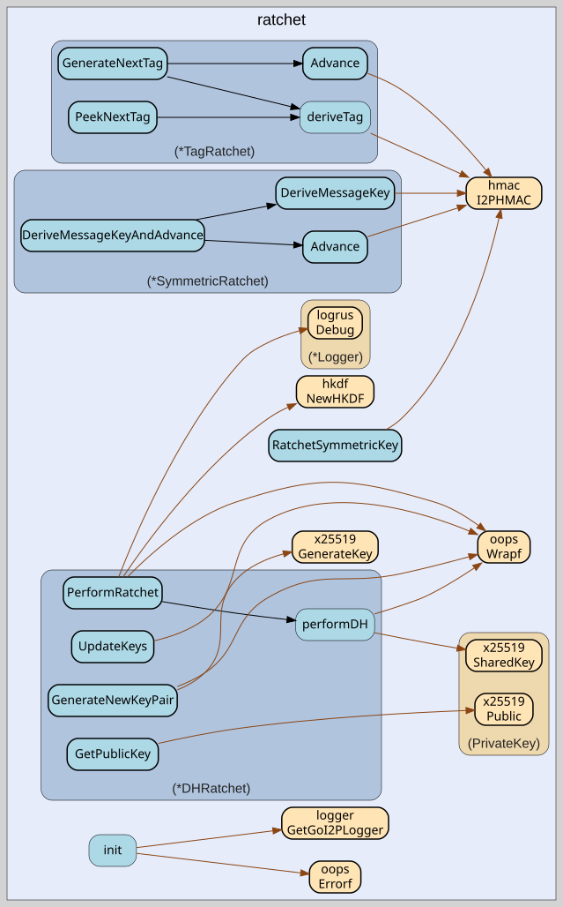

# ratchet
--
    import "github.com/go-i2p/crypto/ratchet"



Package ratchet implements the key-ratcheting mechanisms used by modern I2P
encryption.

# What a ratchet is

A ratchet is a one-way chain of keys. You start with one key and can derive the
next key from it, but you cannot go backwards. This gives forward secrecy: if an
attacker later steals the current key, they still cannot read messages that were
encrypted with earlier keys, because those earlier keys can no longer be
recovered.

# The three ratchets

I2P's ECIES-X25519-AEAD-Ratchet protocol (Proposal 144) uses three ratchets
together. This package provides each one:

    - TagRatchet: derives the short session tags that identify a
      message's place in a session.
    - SymmetricRatchet: derives the message encryption keys, advancing
      one step per message.
    - DHRatchet: periodically performs a fresh X25519 Diffie-Hellman
      exchange to refresh the root key, which is the strongest form of
      forward secrecy.

# How it fits the I2P specification

These ratchets are the "ratchets" that replace the old SessionTags in the
ECIES-X25519-AEAD-Ratchet specification. The design borrows the idea from the
Signal double ratchet.

The key-derivation steps use HKDF-SHA256 (RFC 5869) with the spec's info
strings, matching the I2P specification:

    - DH_INITIALIZE / DH_INITIALIZEFull: HKDF(rootKey, k, "KDFDHRatchetStep", 64)
      followed by HKDF(ck, ZEROLEN, "TagAndKeyGenKeys", 64).
    - TagRatchet: HKDF(chainKey, ZEROLEN, "STInitialization", 64) to
      seed, then HKDF(chainKey, SESSTAG_CONSTANT, "SessionTagKeyGen", 64) per
      step.
    - SymmetricRatchet: HKDF(chainKey, ZEROLEN, "SymmetricRatchet", 64).

See the official specification for the full protocol:
https://i2p.net/en/docs/specs/ecies/

Historical note: an earlier revision of this package used a Signal-style
HMAC-SHA256 construction ("MessageKey"/"NextChainKey") that did not match the
spec. That was corrected to the HKDF construction above.

# A note on construction

Always create a DHRatchet with NewDHRatchet rather than a struct literal, so
that its internal state is initialized correctly.

# Session

The Session type ties the three ratchets together and enforces the spec's
data-phase rules: message numbers 0..65535 inclusive per tag set (after which a
DH ratchet step is required, see ErrTagsetExhausted) and a receiver lookahead
window (default 32, maximum 128) for out-of-order session tags.

Each direction of traffic keeps its own symmetric ratchet, tag ratchet, message
counter and lookahead window. That separation is mandated by spec section 4a:
"After the final handshake KDF on bound sessions, Bob and Alice must run the
Noise Split() function on the resulting CipherState to create independent
symmetric and tag chain keys for inbound and outbound sessions." Split()
implements it, and NewSessionFromECIESWithRole applies it.

Because both peers run the same split over the same key, the two endpoints of a
session must be given opposite roles: the initiator sends on the first Split key
and receives on the second, the responder does the reverse. When a single program
creates both sides (tests, in-process tunnels), construct one with RoleInitiator
and the other with RoleResponder; two sessions created with the same role are the
same session and their outbound chains collide. NewSessionFromECIES is the
initiator-side convenience wrapper.

A session created from raw ECIES key material applies the spec's Split,
DH_INITIALIZE and TagAndKeyGenKeys KDFs, but its initial seed is not
handshake-derived, so the result will not interoperate with a Java I2P router;
see the function's own documentation for the details and scope boundary.

# What is not implemented

The full bound-session protocol is out of scope for this package: the New Session
Reply handshake (spec section 1g) and its SessionReplyTags KDF, the payload block
format and ordering rules (section 5), the NextKey/ACK blocks, and the key /
tag-set ID progression of section 4a (tag set ID = 1 + Alice's key ID + Bob's key
ID, maximum key ID 32767) are all absent. PerformDHRatchet advances only the
outbound direction; the inbound half of a NextKey exchange is
Session.PerformReceivingDHRatchet, but nothing here parses or emits the NextKey
block that drives it.

## Usage

```go
const (
	// ChainKeySize is the size of chain keys in bytes
	ChainKeySize = 32
	// SessionTagSize is the size of session tags in bytes
	SessionTagSize = 8
	// MessageKeySize is the size of message keys in bytes
	MessageKeySize = 32
	// PublicKeySize is the size of X25519 public keys in bytes
	PublicKeySize = 32
	// PrivateKeySize is the size of X25519 private keys in bytes
	PrivateKeySize = 32
	// NonceSize is the size of the ChaCha20-Poly1305 AEAD nonce in bytes. Per
	// the I2P ECIES spec section 3 the first four bytes are always zero and the
	// last eight are the little-endian message number.
	NonceSize = 12

	// MaxMessagesPerTagset is the maximum valid AEAD message number for a
	// single tag set, inclusive. Per the I2P ECIES spec (section 3): "Maximum
	// value is 65535. Higher values must never be used." Because 65535 is a
	// valid number, a tag set carries numbers 0..65535, i.e. up to 65536
	// messages, matching the spec's "A Tag Set can be up to 65536 tags."
	// The DH ratchet must advance only once the counter exceeds this value.
	MaxMessagesPerTagset = 65535

	// DefaultLookaheadWindow is the default receiver look-ahead window size
	// for session tag validation. Per the I2P ECIES spec (section 4b):
	// "N might be at most 128, but 32 or even less may be a better choice."
	DefaultLookaheadWindow = 32

	// MaxLookaheadWindow is the maximum receiver look-ahead window size
	// permitted by the I2P ECIES spec (section 4b).
	MaxLookaheadWindow = 128
)
```
Constants for ratchet operations

```go
var (
	ErrInvalidChainKeySize   = oops.Errorf("invalid chain key size")
	ErrInvalidPublicKeySize  = oops.Errorf("invalid public key size")
	ErrInvalidPrivateKeySize = oops.Errorf("invalid private key size")
	ErrTagDerivationFailed   = oops.Errorf("session tag derivation failed")
	ErrKeyDerivationFailed   = oops.Errorf("key derivation failed")
	ErrDHFailed              = oops.Errorf("Diffie-Hellman exchange failed")

	// ErrTagsetExhausted indicates the current tag set has used every valid
	// message number (0..MaxMessagesPerTagset inclusive) and the DH ratchet
	// must advance before further messages can be sent.
	ErrTagsetExhausted = oops.Errorf("tag set exhausted: DH ratchet required")
)
```
Error constants for ratchet operations

#### func  DH_INITIALIZE

```go
func DH_INITIALIZE(rootKey [ChainKeySize]byte, k [32]byte) [32]byte
```
DH_INITIALIZE implements the spec's DH ratchet initialization step. Per
ecies.rst (DH INITIALIZATION KDF):

    keydata = HKDF(salt=rootKey, ikm=k, info="KDFDHRatchetStep", 64)
    nextRootKey = keydata[0:32]
    ck          = keydata[32:64]

It returns the chain key (ck) that initializes the new session tag and symmetric
key ratchets for the tag set. The nextRootKey (keydata[0:32]) is the KDF input
for a subsequent DH ratchet in the same direction; callers that need it should
use DH_INITIALIZEFull.

#### func  DH_INITIALIZEFull

```go
func DH_INITIALIZEFull(rootKey [ChainKeySize]byte, k [32]byte) (nextRootKey [32]byte, ck [32]byte, err error)
```
DH_INITIALIZEFull implements the full spec DH INITIALIZATION KDF, returning both
the next root key (keydata[0:32]) and the chain key (keydata[32:64]).

    keydata = HKDF(salt=rootKey, ikm=k, info="KDFDHRatchetStep", 64)

#### func  Split

```go
func Split(chainKey [ChainKeySize]byte) (k1, k2 [ChainKeySize]byte, err error)
```
Split implements the Noise Split() function that the I2P ECIES spec requires
after the final handshake KDF (section 4a, DH Ratchet):

    "After the final handshake KDF on bound sessions, Bob and Alice must run
    the Noise Split() function on the resulting CipherState to create
    independent symmetric and tag chain keys for inbound and outbound
    sessions."

Noise (protocol.pdf section 5.2.3) defines Split on the SymmetricState chaining
key:

    temp_hk = HKDF(ck, zerolen, "", 64)
    temp_k1 = temp_hk[0:32]
    temp_k2 = temp_hk[32:64]

The two outputs seed the two directions, so that inbound and outbound messages
never share a key chain, a tag chain, or a nonce counter. The initiator uses
temp_k1 to send and temp_k2 to receive; the responder uses them the other way
round (see Role). The input chain key is treated as spent: Noise zeroes ck after
Split, and callers must not derive anything else from it.

#### func  DataNonce

```go
func DataNonce(n uint32) [NonceSize]byte
```
DataNonce builds the Existing Session AEAD nonce from a message number, per the
I2P ECIES spec section 3: a 12-byte counter nonce whose first four bytes are
always zero and whose last eight bytes are the message number n in little-endian
order.

The spec caps n at 65535 ("Higher values must never be used"); callers should
enforce that through the tag-set limit rather than relying on this function.

#### func  RatchetSymmetricKey

```go
func RatchetSymmetricKey(chainKey [ChainKeySize]byte, messageNum uint32) ([MessageKeySize]byte, [ChainKeySize]byte, error)
```
RatchetSymmetricKey derives the next message key and new chain key for symmetric
ratcheting, per the I2P ECIES spec (section 4c, SymmetricRatchet):

    keydata = HKDF(ikm=ZEROLEN, salt=chainKey, info="SymmetricRatchet", 64)
    newChainKey = keydata[0:32]
    messageKey  = keydata[32:64]

The message number is not part of the KDF; it is accepted for API compatibility
with existing callers.

#### type DHRatchet

```go
type DHRatchet struct {
}
```

DHRatchet implements the Diffie-Hellman ratchet for forward secrecy. It performs
periodic DH key exchanges to derive new chain keys.

The DH ratchet provides the strongest form of forward secrecy - even if an
attacker compromises the current state, they cannot decrypt past messages.

⚠️ CRITICAL SECURITY WARNING: Do NOT construct DHRatchet directly using var or
struct literals. Always use NewDHRatchet() to ensure proper initialization.

BAD:

    var ratchet DHRatchet              // Zero keys - cryptographically invalid!
    ratchet := DHRatchet{...}          // Missing validation

GOOD:

    ratchet := NewDHRatchet(rootKey, ourPrivKey, theirPubKey)

#### func  NewDHRatchet

```go
func NewDHRatchet(rootKey, ourPrivKey, theirPubKey [ChainKeySize]byte) *DHRatchet
```
NewDHRatchet creates a new DH ratchet with initial root key and keys.

#### func (*DHRatchet) GenerateNewKeyPair

```go
func (r *DHRatchet) GenerateNewKeyPair() ([PublicKeySize]byte, error)
```
GenerateNewKeyPair generates a new ephemeral key pair for this ratchet.

#### func (*DHRatchet) GetPublicKey

```go
func (r *DHRatchet) GetPublicKey() ([PublicKeySize]byte, error)
```
GetPublicKey returns our current DH public key.

#### func (*DHRatchet) PerformRatchet

```go
func (r *DHRatchet) PerformRatchet() ([ChainKeySize]byte, [ChainKeySize]byte, error)
```
PerformRatchet performs a DH ratchet step.

Spec ref: ecies.rst §"DH Ratchet KDF" —

    sharedSecret = DH(rask, rbpk)
    tagsetKey = HKDF(sharedSecret, ZEROLEN, "XDHRatchetTagSet", 32)
    rootKey = nextRootKey // from previous tagset in this direction
    newTagSet = DH_INITIALIZE(rootKey, tagsetKey)

Returns (nextRootKey, ck) where nextRootKey is the updated root key for the next
ratchet step in this direction, and ck is the chain key output of DH_INITIALIZE.
The caller must apply the TagAndKeyGenKeys KDF to ck to obtain the session tag
chain key and symmetric key chain key.

#### func (*DHRatchet) SetRootKey

```go
func (r *DHRatchet) SetRootKey(rootKey [ChainKeySize]byte)
```
SetRootKey sets the root key used as input to DH_INITIALIZE on the next
PerformRatchet call. This is used by the Session to select the correct
per-direction root key before performing a ratchet step.

#### func (*DHRatchet) UpdateKeys

```go
func (r *DHRatchet) UpdateKeys(newTheirPubKey []byte) error
```
UpdateKeys updates the DH ratchet with a new remote public key.

#### func (*DHRatchet) Zero

```go
func (r *DHRatchet) Zero()
```
Zero securely clears the DH ratchet state from memory.

#### type HandshakeResult

```go
type HandshakeResult struct {
	SharedSecret [32]byte // The ECIES-X25519 shared secret
	OurPrivKey   [32]byte // Our ephemeral private key
	TheirPubKey  [32]byte // Their public key
}
```

HandshakeResult contains the output of an ECIES key exchange handshake

#### type Role

```go
type Role uint8
```

Role identifies which side of a session a local endpoint is, so that the two
directions get the correct halves of the Noise Split() output.

The spec assigns the two Split() keys by handshake role (section 4a: the split
creates "independent symmetric and tag chain keys for inbound and outbound
sessions"; Noise orders them so the handshake initiator uses the first key for
sending and the responder uses the second). Because the two peers must disagree
on the role, both endpoints cannot use the zero value: construct the responder
with RoleResponder.

#### type Session

```go
type Session struct {
}
```

Session combines DH ratchet, symmetric ratchet, and tag ratchet into a single
coherent unit for ECIES-X25519-AEAD-Ratchet protocol. This provides a unified
API for I2P garlic message encryption with forward secrecy.

The Session handles:

    - DH ratchet for periodic key agreement
    - Symmetric ratchet for deriving message encryption keys
    - Tag ratchet for session tag generation

Per the I2P ECIES spec (section 4), the ratchets are bidirectional and each
direction is independent: after the handshake chain key is obtained, the
mandatory Noise Split() produces two separate CipherState keys, and each
direction keeps its own symmetric ratchet, tag ratchet, message counter and
look-ahead window. A ratchet "is for a single direction, and generates a New
Session tag / message key ratchet chain for that direction. To generate keys for
both directions, you have to ratchet twice", so each direction also keeps its own
root key for the next DH ratchet step.

#### func  NewSessionFromECIES

```go
func NewSessionFromECIES(sharedSecret, ourPrivKey, theirPubKey [32]byte) (*Session, error)
```
NewSessionFromECIES creates a new session initialized from an ECIES shared
secret, with the local endpoint as the handshake initiator. It is equivalent to
NewSessionFromECIESWithRole with RoleInitiator; use the latter when both
endpoints of a session are created in the same process, since the two peers must
be given opposite roles.

The shared secret stands in for the handshake chaining key. The spec's mandatory
Noise Split() produces one key per direction, and each direction is then
initialized independently through the DH INITIALIZATION KDF (section 4):

    [k1, k2] = Split(rootKey)                    // section 4a, Noise split
    k        = k1 outbound, k2 inbound (swapped for the responder)
    keydata  = HKDF(salt=rootKey, ikm=k, info="KDFDHRatchetStep", 64)
    nextRootKey = keydata[0:32]
    ck          = keydata[32:64]
    keydata  = HKDF(salt=ck, ikm=ZEROLEN, info="TagAndKeyGenKeys", 64)
    sessTag_ck = keydata[0:32]
    symmKey_ck = keydata[32:64]

This is the recommended way to create a session after ECIES key exchange.

# Limitation: the initial keys are not derived per the specification

The spec obtains the ratchet inputs from the New Session Reply handshake:
DH_INITIALIZE takes rootKey = "chainKey from Payload Section" and k = "from the
New Session KDF or split()", and the two directions get separate tag sets ("The
chainKey and k from Bob's NSR Payload Section are used as inputs for the initial
ES DH Ratchets (both directions...)").

This constructor has no handshake payload section to draw on, so it uses the
caller's shared secret as the payload chain key. The KDFs it applies (Split,
KDFDHRatchetStep, TagAndKeyGenKeys, STInitialization, SessionTagKeyGen,
SymmetricRatchet) are exactly the spec's, and the directions are independent as
section 4a requires, but the initial seed is not handshake-derived, so a session
created here will not interoperate with a Java I2P router. Use it for local
ratcheting and tests; for on-network sessions the keys must come from a
spec-compliant New Session / New Session Reply handshake, which this package does
not implement (see the ecies package docs for the scope boundary).

Parameters:

    - sharedSecret: The 32-byte ECIES-X25519 shared secret
    - ourPrivKey: Our ephemeral private key (for DH ratchet)
    - theirPubKey: Their public key (for DH ratchet)

Returns:

    - *Session: The initialized session ready for message encryption
    - error: Any error during key derivation

Example:

    // After ECIES key exchange
    session, err := ratchet.NewSessionFromECIES(sharedSecret, ourPriv, theirPub)
    if err != nil {
        return err
    }
    defer session.Zero()

    // Encrypt message: the session yields the per-message key, the session tag,
    // and the spec's counter nonce; the caller does the ChaCha20-Poly1305
    // encryption with them.
    messageKey, tag, nonce, _ := session.EncryptMessage(plaintext)

#### func  NewSessionFromECIESWithRole

```go
func NewSessionFromECIESWithRole(sharedSecret, ourPrivKey, theirPubKey [32]byte, role Role) (*Session, error)
```
NewSessionFromECIESWithRole creates a session from an ECIES shared secret and
assigns the local endpoint a handshake role, which determines which half of the
Noise Split() output each direction uses.

Spec section 4a makes the split mandatory: "After the final handshake KDF on
bound sessions, Bob and Alice must run the Noise Split() function on the
resulting CipherState to create independent symmetric and tag chain keys for
inbound and outbound sessions." Both peers run the same split on the same chain
key, so the role is what keeps the two directions from colliding: the initiator
sends on k1 and receives on k2, the responder sends on k2 and receives on k1.

When a single program creates both endpoints (tests, in-process tunnels), give
them opposite roles; if both are created with RoleInitiator they are the same
session and their outbound chains collide. NewSessionFromECIES is the
initiator-side convenience wrapper.

#### func  NewSessionFromHandshake

```go
func NewSessionFromHandshake(handshake HandshakeResult) (*Session, error)
```
NewSessionFromHandshake creates a new session from a handshake result. This is a
convenience wrapper around NewSessionFromECIES.

Parameters:

    - handshake: The result of an ECIES key exchange

Returns:

    - *Session: The initialized session
    - error: Any error during session creation

Example:

    handshake := HandshakeResult{
        SharedSecret: eciesSharedSecret,
        OurPrivKey:   ourEphemeralPriv,
        TheirPubKey:  theirStaticPub,
    }
    session, err := ratchet.NewSessionFromHandshake(handshake)

#### func (*Session) DecryptMessage

```go
func (s *Session) DecryptMessage(tag [8]byte) (messageKey [32]byte, nonce [NonceSize]byte, err error)
```
DecryptMessage looks up a received session tag in the receiver's look-ahead
window and returns the message key and AEAD nonce associated with it.

Tags are matched against the pre-computed window so that out-of-order delivery
within the window still resolves to the correct key; the tag and symmetric key
ratchets advance in lockstep as the contiguous head of the window is consumed.

Parameters:

    - tag: The 8-byte session tag received with the ciphertext

Returns:

    - messageKey: The 32-byte decryption key to use with ChaCha20-Poly1305
    - nonce: The 12-byte counter nonce for this message's number
    - error: Any error if the tag is invalid

Example:

    messageKey, nonce, err := session.DecryptMessage(sessionTag)
    if err != nil {
        return err
    }

    // Use messageKey with ChaCha20-Poly1305 AEAD
    aead, _ := chacha20poly1305.NewAEAD(messageKey)
    plaintext, _ := aead.Decrypt(ciphertext, authTag, sessionTag[:], nonce[:])

#### func (*Session) EncryptMessage

```go
func (s *Session) EncryptMessage(plaintext []byte) (messageKey [32]byte, tag [8]byte, nonce [NonceSize]byte, err error)
```
EncryptMessage advances the ratchets and returns the message key, session tag,
and AEAD nonce for the next outbound message. This method:

    1. Generates a unique session tag for this message
    2. Derives a message encryption key from the symmetric ratchet
    3. Computes the spec's counter nonce from the message number
    4. Advances both ratchets for forward secrecy

It does NOT itself encrypt the plaintext: the caller must use the returned
messageKey and nonce with a ChaCha20-Poly1305 AEAD to produce the ciphertext,
and send that ciphertext together with the returned session tag so the recipient
can identify which session (and message) it belongs to. Per spec section 1h the
session tag is the AEAD associated data.

Parameters:

    - plaintext: The message to derive a key for (used only for logging; the
      caller encrypts it with the returned key)

Returns:

    - messageKey: The 32-byte encryption key to use with ChaCha20-Poly1305
    - tag: The 8-byte session tag (also the AEAD associated data)
    - nonce: The 12-byte counter nonce for this message
    - error: Any error during encryption

Example:

    messageKey, sessionTag, nonce, err := session.EncryptMessage(plaintext)
    if err != nil {
        return err
    }

    // Use messageKey with ChaCha20-Poly1305 AEAD
    aead, _ := chacha20poly1305.NewAEAD(messageKey)
    ciphertext, authTag, _ := aead.Encrypt(plaintext, sessionTag[:], nonce[:])

#### func (*Session) GenerateNewDHKeyPair

```go
func (s *Session) GenerateNewDHKeyPair() ([32]byte, error)
```
GenerateNewDHKeyPair generates a fresh ephemeral key pair for this endpoint's DH
ratchet and returns the public key to send to the peer in a NextKey block.

#### func (*Session) GetMessageNumber

```go
func (s *Session) GetMessageNumber() uint32
```
GetMessageNumber returns the current sending-direction message number.

#### func (*Session) GetNextTag

```go
func (s *Session) GetNextTag() ([8]byte, error)
```
GetNextTag returns the next session tag this endpoint would send, without
advancing the sending ratchet. This is useful for tag validation and session
lookup. To inspect the inbound direction, use GetReceivingNextTag.

Returns:

    - [8]byte: The next expected session tag

#### func (*Session) GetReceivingMessageNumber

```go
func (s *Session) GetReceivingMessageNumber() uint32
```
GetReceivingMessageNumber returns the current receiving-direction message
number, i.e. the number of inbound messages consumed in the current tag set.

#### func (*Session) GetReceivingNextTag

```go
func (s *Session) GetReceivingNextTag() ([8]byte, error)
```
GetReceivingNextTag returns the next session tag expected from the peer without
advancing the receiving ratchet.

#### func (*Session) PerformDHRatchet

```go
func (s *Session) PerformDHRatchet() (chainKey, nextRootKey [32]byte, err error)
```
PerformDHRatchet performs a Diffie-Hellman ratchet step in the sending direction
to derive a new tag set. This should be called periodically to maintain forward
secrecy.

Per the spec (section 4, DH RATCHET KDF + DH INITIALIZATION KDF), the chain key
output of DH_INITIALIZE is split via the TagAndKeyGenKeys KDF:

    keydata = HKDF(salt=ck, ikm=ZEROLEN, info="TagAndKeyGenKeys", 64)
    sessTag_ck = keydata[0:32]
    symmKey_ck = keydata[32:64]

The sending direction's symmetric and tag ratchets are reinitialized from the
split, and the sending-direction root key is advanced. The receiving direction is
untouched: section 4a says "a ratchet is for a single direction", so the inbound
half of a NextKey exchange is the separate Session.PerformReceivingDHRatchet call.

Returns:

    - chainKey: The DH chain key (ck) output of DH_INITIALIZE
    - nextRootKey: The new root key for the sending direction
    - error: Any error during ratchet operation

Example:

    // Periodically refresh keys
    ck, nextRootKey, err := session.PerformDHRatchet()
    if err != nil {
        return err
    }

#### func (*Session) PerformReceivingDHRatchet

```go
func (s *Session) PerformReceivingDHRatchet() (chainKey, nextRootKey [32]byte, err error)
```
PerformReceivingDHRatchet performs the DH ratchet step for the inbound direction
after the peer has sent a new key, completing the key exchange. The spec requires
a ratchet in each direction whenever new keys are exchanged, so a NextKey
exchange involves two calls: PerformDHRatchet for the outbound direction and this
one for the inbound direction.

Returns:

    - chainKey: The DH chain key (ck) output of DH_INITIALIZE for the inbound direction
    - nextRootKey: The new root key for the receiving direction
    - error: Any error during ratchet operation

#### func (*Session) Role

```go
func (s *Session) Role() Role
```
Role returns the handshake role this endpoint was created with, which determines
which half of the Noise Split() output it sends on.

#### func (*Session) UpdateRemotePublicKey

```go
func (s *Session) UpdateRemotePublicKey(newPubKey [32]byte) error
```
UpdateRemotePublicKey updates the remote party's public key for DH ratchet. This
is used when the remote party rotates their ephemeral key.

Parameters:

    - newPubKey: The new remote public key

Returns:

    - error: Any error during key update

#### func (*Session) Zero

```go
func (s *Session) Zero()
```
Zero securely clears all session state from memory. This should be called when
the session is no longer needed.

#### type SymmetricRatchet

```go
type SymmetricRatchet struct {
}
```

SymmetricRatchet implements the symmetric key ratchet for deriving message keys.
Each message is encrypted with a unique key derived from the chain key.

The ratchet provides forward secrecy - message keys cannot be derived from later
chain keys, and compromise of one message key doesn't affect others.

⚠️ CRITICAL SECURITY WARNING: Do NOT construct SymmetricRatchet directly using
var or struct literals. Always use NewSymmetricRatchet() to ensure proper
initialization.

BAD:

    var ratchet SymmetricRatchet       // Zero chain key - cryptographically invalid!
    ratchet := SymmetricRatchet{...}   // Missing validation

GOOD:

    ratchet := NewSymmetricRatchet(initialChainKey)

#### func  NewSymmetricRatchet

```go
func NewSymmetricRatchet(initialChainKey [ChainKeySize]byte) *SymmetricRatchet
```
NewSymmetricRatchet creates a new symmetric key ratchet.

#### func (*SymmetricRatchet) Advance

```go
func (r *SymmetricRatchet) Advance() error
```
Advance advances the symmetric ratchet by deriving a new chain key. Per the I2P
ECIES spec (section 4c), the new chain key is the first half of keydata =
HKDF(ikm=ZEROLEN, salt=chainKey, info="SymmetricRatchet", 64).

#### func (*SymmetricRatchet) DeriveMessageKey

```go
func (r *SymmetricRatchet) DeriveMessageKey(messageNum uint32) ([MessageKeySize]byte, error)
```
DeriveMessageKey derives the message key for the current chain key. Per the I2P
ECIES spec (section 4c), the message key is the second half of keydata =
HKDF(ikm=ZEROLEN, salt=chainKey, info="SymmetricRatchet", 64). The message
number is not part of the KDF; it is accepted for API compatibility with
existing callers.

#### func (*SymmetricRatchet) DeriveMessageKeyAndAdvance

```go
func (r *SymmetricRatchet) DeriveMessageKeyAndAdvance(messageNum uint32) ([MessageKeySize]byte, [ChainKeySize]byte, error)
```
DeriveMessageKeyAndAdvance derives a message key and advances the chain in one
operation. This is a convenience function combining DeriveMessageKey and
Advance.

#### func (*SymmetricRatchet) GetChainKey

```go
func (r *SymmetricRatchet) GetChainKey() [ChainKeySize]byte
```
GetChainKey returns the current chain key (for inspection/debugging).

#### func (*SymmetricRatchet) Zero

```go
func (r *SymmetricRatchet) Zero()
```
Zero securely clears the symmetric ratchet state from memory.

#### type TagRatchet

```go
type TagRatchet struct {
}
```

TagRatchet implements the I2P ECIES session tag ratchet (spec section 4b).
Session tags are 8-byte identifiers used to route existing session messages
without revealing session metadata in cleartext.

The ratchet is initialized from a session tag chain key (sessTag_ck) via the
STInitialization KDF, which produces the first chain key and a per-tag-set
constant (SESSTAG_CONSTANT). Each subsequent tag is derived by KDF_ST, which
advances the chain key and emits an 8-byte session tag.

Per ecies.rst (Session Tag Ratchet KDF):

    // Initialization
    keydata = HKDF(sessTag_ck, ZEROLEN, "STInitialization", 64)
    sessTag_chainKey = keydata[0:32]
    SESSTAG_CONSTANT = keydata[32:64]

    // KDF_ST(ck, constant)
    keydata = HKDF(sessTag_chainKey, SESSTAG_CONSTANT, "SessionTagKeyGen", 64)
    sessTag_chainKey = keydata[0:32]
    tag = keydata[32:40]

⚠️ CRITICAL SECURITY WARNING: Do NOT construct TagRatchet directly using var or
struct literals. Always use NewTagRatchet() to ensure proper initialization.

BAD:

    var ratchet TagRatchet             // Zero chain key - cryptographically invalid!
    ratchet := TagRatchet{...}         // Missing validation

GOOD:

    ratchet := NewTagRatchet(sessTagCK)

#### func  NewTagRatchet

```go
func NewTagRatchet(sessTagCK [ChainKeySize]byte) *TagRatchet
```
NewTagRatchet creates a new session tag ratchet from a session tag chain key
(sessTag_ck), running the STInitialization KDF to derive the first chain key and
the per-tag-set SESSTAG_CONSTANT.

#### func (*TagRatchet) Advance

```go
func (r *TagRatchet) Advance() error
```
Advance advances the tag ratchet by deriving a new chain key via KDF_ST.

#### func (*TagRatchet) GenerateNextTag

```go
func (r *TagRatchet) GenerateNextTag() ([SessionTagSize]byte, error)
```
GenerateNextTag derives the next 8-byte session tag and advances the ratchet.

#### func (*TagRatchet) GetTagCount

```go
func (r *TagRatchet) GetTagCount() uint32
```
GetTagCount returns the current tag count (number of tags generated).

#### func (*TagRatchet) PeekNextTag

```go
func (r *TagRatchet) PeekNextTag() ([SessionTagSize]byte, error)
```
PeekNextTag derives the next session tag without advancing the ratchet. This is
used for tag validation without commitment.

#### func (*TagRatchet) Zero

```go
func (r *TagRatchet) Zero()
```
Zero securely clears the tag ratchet state from memory.


ratchet 

github.com/go-i2p/crypto/ratchet

[go-i2p template file](/template.md)
