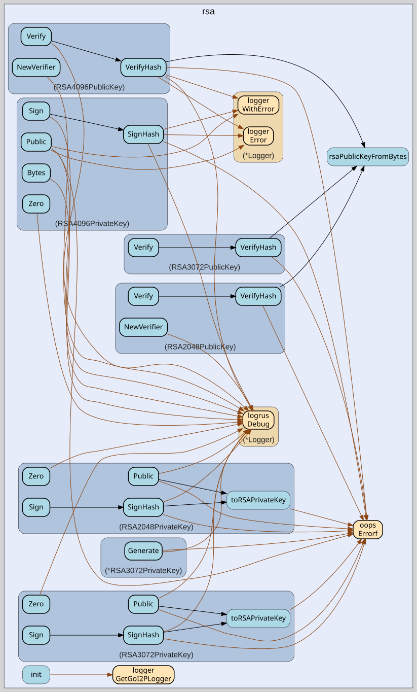

# rsa
--
    import "github.com/go-i2p/crypto/rsa"



Package rsa provides RSA (Rivest-Shamir-Adleman) signing for I2P.

# Deprecated: legacy algorithm

RSA is a legacy signature scheme in I2P. It is kept for compatibility with older
routers and for verifying legacy data, but new code should use the ed25519 or
red25519 packages, which are faster and more secure.

RSA is a widely used public-key algorithm. A key pair consists of a public key
(for verifying signatures) and a private key (for creating them). This package
supports 2048-bit, 3072-bit, and 4096-bit keys.

Approximate symmetric-equivalent security strengths (NIST SP 800-57): RSA-2048 ≈
112 bits, RSA-3072 ≈ 128 bits, RSA-4096 ≈ 140-152 bits.

# How it works

    - The signer hashes the data with a key-size-appropriate hash: SHA-256
      for RSA-2048, SHA-384 for RSA-3072, and SHA-512 for RSA-4096. These
      match the I2P signature types RSA_SHA256_2048 (4), RSA_SHA384_3072 (5)
      and RSA_SHA512_4096 (6).
    - The signer creates a signature using its private key.
    - A verifier checks the signature against the signer's public key.

# Key construction

Always use the provided constructors (for example NewRSA2048PrivateKey) to
create keys. Constructing a key type directly with a zero value produces an
invalid key.

See RFC 3447 for the RSA specification:
https://datatracker.ietf.org/doc/html/rfc3447

## Usage

```go
var (
	// ErrInvalidKeySize indicates that the provided RSA key size is not supported or valid.
	// Valid RSA key sizes in I2P are 2048, 3072, and 4096 bits.
	ErrInvalidKeySize = oops.Errorf("invalid RSA key size")

	// ErrInvalidKeyFormat indicates that the RSA key data is malformed or corrupted.
	// RSA keys must follow I2P's standard byte array format for proper parsing.
	ErrInvalidKeyFormat = oops.Errorf("invalid RSA key format")

	// ErrSignatureFailed indicates that the RSA signature generation operation failed.
	// This can occur due to invalid keys, insufficient entropy, or cryptographic errors.
	ErrSignatureFailed = oops.Errorf("RSA signature operation failed")

	// ErrVerificationFailed indicates that RSA signature verification failed.
	// This occurs when a signature does not match the provided data and public key.
	ErrVerificationFailed = oops.Errorf("RSA signature verification failed")
)
```
Error constants for RSA operations

#### func  GenerateRSA2048KeyPair

```go
func GenerateRSA2048KeyPair() (*RSA2048PublicKey, *RSA2048PrivateKey, error)
```
GenerateRSA2048KeyPair generates a new RSA-2048 key pair for I2P cryptographic
operations. Returns a public key for verification and a private key for signing
operations. RSA-2048 provides 112-bit equivalent security and is suitable for
most I2P applications. The generated keys follow I2P's standard byte array
format for compatibility. Example usage: pubKey, privKey, err :=
GenerateRSA2048KeyPair()

#### func  GenerateRSA3072KeyPair

```go
func GenerateRSA3072KeyPair() (*RSA3072PublicKey, *RSA3072PrivateKey, error)
```
GenerateRSA3072KeyPair generates a new RSA-3072 key pair for enhanced I2P
security. Returns a public key for verification and a private key for signing
operations. RSA-3072 provides 128-bit equivalent security, suitable for
high-security I2P applications. The generated keys follow I2P's standard byte
array format for network compatibility. Example usage: pubKey, privKey, err :=
GenerateRSA3072KeyPair()

#### func  GenerateRSA4096KeyPair

```go
func GenerateRSA4096KeyPair() (*RSA4096PublicKey, *RSA4096PrivateKey, error)
```
GenerateRSA4096KeyPair generates a new RSA-4096 key pair for maximum I2P
security. Returns a public key for verification and a private key for signing
operations. RSA-4096 provides roughly 140-152-bit equivalent symmetric security
(NIST SP 800-57), the highest security level in the RSA family. The generated
keys follow I2P's standard byte array format for network interoperability.
Example usage: pubKey, privKey, err := GenerateRSA4096KeyPair()

#### type RSA2048PrivateKey

```go
type RSA2048PrivateKey struct {
	RSA2048PrivateKey [512]byte // I2P-compliant: 256 bytes modulus + 256 bytes private exponent
}
```

RSA2048PrivateKey represents a 2048-bit RSA private key in I2P format. The key
data is stored as a 512-byte array containing both the modulus (256 bytes) and
private exponent (256 bytes) as specified by I2P cryptographic standards. This
type implements types.Signer for creating digital signatures.

⚠️ CRITICAL SECURITY WARNING ⚠️ Always use NewRSA2048PrivateKey() to create
instances. Do NOT construct directly with &RSA2048PrivateKey{} or
RSA2048PrivateKey{}.

Example usage:

    // WRONG - Creates invalid zero-value key
    var key RSA2048PrivateKey

    // CORRECT - Validates key data
    key, err := NewRSA2048PrivateKey(keyBytes)

#### func  NewRSA2048PrivateKey

```go
func NewRSA2048PrivateKey(data []byte) (*RSA2048PrivateKey, error)
```
NewRSA2048PrivateKey creates a validated RSA-2048 private key from bytes.

The input data must be exactly 512 bytes in I2P format:

    - First 256 bytes: modulus (N) in big-endian
    - Next 256 bytes: private exponent (D) in big-endian

Returns an error if:

    - data length is not exactly 512 bytes
    - data is all zeros (cryptographically invalid)

The returned key is a defensive copy - modifications to the input slice will not
affect the key.

#### func (RSA2048PrivateKey) Bytes

```go
func (r RSA2048PrivateKey) Bytes() []byte
```
Bytes implements types.PrivateKey. Returns the raw bytes of the private key

#### func (RSA2048PrivateKey) Generate

```go
func (r RSA2048PrivateKey) Generate() (types.SigningPrivateKey, error)
```
Generate implements types.SigningPrivateKey.

#### func (RSA2048PrivateKey) Len

```go
func (r RSA2048PrivateKey) Len() int
```
Len implements types.SigningPrivateKey.

#### func (RSA2048PrivateKey) NewSigner

```go
func (r RSA2048PrivateKey) NewSigner() (types.Signer, error)
```
NewSigner implements types.SigningPrivateKey.

#### func (RSA2048PrivateKey) Public

```go
func (r RSA2048PrivateKey) Public() (types.SigningPublicKey, error)
```
Public implements types.PrivateKey. Extracts the public key from the private key

#### func (RSA2048PrivateKey) Sign

```go
func (r RSA2048PrivateKey) Sign(data []byte) (sig []byte, err error)
```
Sign implements types.Signer. Signs data by first hashing it with SHA-256

#### func (RSA2048PrivateKey) SignHash

```go
func (r RSA2048PrivateKey) SignHash(h []byte) (sig []byte, err error)
```
SignHash implements types.Signer. Signs a pre-computed hash

#### func (*RSA2048PrivateKey) Zero

```go
func (r *RSA2048PrivateKey) Zero()
```
Zero implements types.PrivateKey. Securely erases key material

#### type RSA2048PublicKey

```go
type RSA2048PublicKey [256]byte
```

RSA2048PublicKey represents a 2048-bit RSA public key in I2P format. The key is
stored as a 256-byte array containing the public key modulus. This type
implements types.Verifier for signature verification operations.

⚠️ CRITICAL SECURITY WARNING ⚠️ Always use NewRSA2048PublicKey() to create
instances. Do NOT construct directly with &RSA2048PublicKey{} or
RSA2048PublicKey{}.

Example usage:

    // WRONG - Creates invalid zero-value key
    var key RSA2048PublicKey

    // CORRECT - Validates key data
    key, err := NewRSA2048PublicKey(keyBytes)

#### func  NewRSA2048PublicKey

```go
func NewRSA2048PublicKey(data []byte) (*RSA2048PublicKey, error)
```
NewRSA2048PublicKey creates a validated RSA-2048 public key from bytes.

The input data must be exactly 256 bytes containing the modulus (N) in
big-endian format as per I2P specifications.

Returns an error if:

    - data length is not exactly 256 bytes
    - data is all zeros (cryptographically invalid)

The returned key is a defensive copy - modifications to the input slice will not
affect the key.

#### func (RSA2048PublicKey) Bytes

```go
func (r RSA2048PublicKey) Bytes() []byte
```
Bytes implements SigningPublicKey. Returns the raw bytes of the public key

#### func (RSA2048PublicKey) Len

```go
func (r RSA2048PublicKey) Len() int
```
Len implements SigningPublicKey. Returns the length of the public key in bytes

#### func (RSA2048PublicKey) NewVerifier

```go
func (r RSA2048PublicKey) NewVerifier() (types.Verifier, error)
```
NewVerifier implements SigningPublicKey. Creates a new verifier object that can
be used to verify signatures

#### func (RSA2048PublicKey) Verify

```go
func (r RSA2048PublicKey) Verify(data, sig []byte) error
```
Verify implements types.Verifier. This method hashes the data with SHA-256 and
verifies the signature

#### func (RSA2048PublicKey) VerifyHash

```go
func (r RSA2048PublicKey) VerifyHash(h, sig []byte) error
```
VerifyHash implements types.Verifier. This method verifies a pre-computed hash
against the signature

#### type RSA3072PrivateKey

```go
type RSA3072PrivateKey struct {
	RSA3072PrivateKey [768]byte // I2P-compliant: 384 bytes modulus + 384 bytes private exponent
}
```

RSA3072PrivateKey represents a 3072-bit RSA private key in I2P format. The key
data is stored as a 768-byte array containing the modulus (384 bytes) and
private exponent (384 bytes) following I2P cryptographic specifications. This
type implements types.Signer and provides enhanced security over RSA-2048.
RSA-3072 offers equivalent security to 128-bit symmetric encryption.

⚠️ CRITICAL SECURITY WARNING ⚠️ Always use NewRSA3072PrivateKey() to create
instances. Do NOT construct directly with &RSA3072PrivateKey{} or
RSA3072PrivateKey{}.

#### func  NewRSA3072PrivateKey

```go
func NewRSA3072PrivateKey(data []byte) (*RSA3072PrivateKey, error)
```
NewRSA3072PrivateKey creates a validated RSA-3072 private key from bytes.

The input data must be exactly 768 bytes in I2P format:

    - First 384 bytes: modulus (N) in big-endian
    - Next 384 bytes: private exponent (D) in big-endian

Returns an error if:

    - data length is not exactly 768 bytes
    - data is all zeros (cryptographically invalid)

The returned key is a defensive copy - modifications to the input slice will not
affect the key.

#### func (RSA3072PrivateKey) Bytes

```go
func (r RSA3072PrivateKey) Bytes() []byte
```
Bytes implements types.PrivateKey - returns raw key bytes

#### func (*RSA3072PrivateKey) Generate

```go
func (r *RSA3072PrivateKey) Generate() (types.SigningPrivateKey, error)
```
Generate creates a new RSA-3072 private key

#### func (*RSA3072PrivateKey) Len

```go
func (r *RSA3072PrivateKey) Len() int
```
Len implements types.SigningPrivateKey.

#### func (*RSA3072PrivateKey) NewSigner

```go
func (r *RSA3072PrivateKey) NewSigner() (types.Signer, error)
```
NewSigner implements types.SigningPrivateKey.

#### func (RSA3072PrivateKey) Public

```go
func (r RSA3072PrivateKey) Public() (types.SigningPublicKey, error)
```
Public implements types.PrivateKey - derives public key from private key

#### func (RSA3072PrivateKey) Sign

```go
func (r RSA3072PrivateKey) Sign(data []byte) (sig []byte, err error)
```
Sign implements types.Signer - signs data with SHA-384 hash

#### func (RSA3072PrivateKey) SignHash

```go
func (r RSA3072PrivateKey) SignHash(h []byte) (sig []byte, err error)
```
SignHash implements types.Signer - signs a pre-computed SHA-384 hash

#### func (*RSA3072PrivateKey) Zero

```go
func (r *RSA3072PrivateKey) Zero()
```
Zero implements types.PrivateKey - securely erases key material

#### type RSA3072PublicKey

```go
type RSA3072PublicKey [384]byte
```

RSA3072PublicKey represents a 3072-bit RSA public key in I2P format. The key is
stored as a 384-byte array containing the public key modulus. This type
implements types.Verifier for signature verification with enhanced security.
RSA-3072 provides equivalent security to 128-bit symmetric encryption.

⚠️ CRITICAL SECURITY WARNING ⚠️ Always use NewRSA3072PublicKey() to create
instances. Do NOT construct directly with &RSA3072PublicKey{} or
RSA3072PublicKey{}.

#### func  NewRSA3072PublicKey

```go
func NewRSA3072PublicKey(data []byte) (*RSA3072PublicKey, error)
```
NewRSA3072PublicKey creates a validated RSA-3072 public key from bytes.

The input data must be exactly 384 bytes containing the modulus (N) in
big-endian format as per I2P specifications.

Returns an error if:

    - data length is not exactly 384 bytes
    - data is all zeros (cryptographically invalid)

The returned key is a defensive copy - modifications to the input slice will not
affect the key.

#### func (RSA3072PublicKey) Bytes

```go
func (r RSA3072PublicKey) Bytes() []byte
```
Bytes implements SigningPublicKey.

#### func (RSA3072PublicKey) Len

```go
func (r RSA3072PublicKey) Len() int
```
Len implements SigningPublicKey.

#### func (RSA3072PublicKey) NewVerifier

```go
func (r RSA3072PublicKey) NewVerifier() (types.Verifier, error)
```
NewVerifier implements SigningPublicKey.

#### func (RSA3072PublicKey) Verify

```go
func (r RSA3072PublicKey) Verify(data, sig []byte) error
```
Verify implements types.Verifier.

#### func (RSA3072PublicKey) VerifyHash

```go
func (r RSA3072PublicKey) VerifyHash(h, sig []byte) error
```
VerifyHash implements types.Verifier.

#### type RSA4096PrivateKey

```go
type RSA4096PrivateKey struct {
	RSA4096PrivateKey [1024]byte // I2P-compliant: 512 bytes modulus + 512 bytes private exponent
}
```

RSA4096PrivateKey represents a 4096-bit RSA private key in I2P format. The key
data is stored as a 1024-byte array containing the modulus (512 bytes) and
private exponent (512 bytes) following I2P cryptographic specifications. This
type implements types.Signer and provides maximum security in the RSA family.
RSA-4096 offers roughly 140-152-bit equivalent symmetric security (NIST SP
800-57).

⚠️ CRITICAL SECURITY WARNING ⚠️ Always use NewRSA4096PrivateKey() to create
instances. Do NOT construct directly with &RSA4096PrivateKey{} or
RSA4096PrivateKey{}.

#### func  NewRSA4096PrivateKey

```go
func NewRSA4096PrivateKey(data []byte) (*RSA4096PrivateKey, error)
```
NewRSA4096PrivateKey creates a validated RSA-4096 private key from bytes.

The input data must be exactly 1024 bytes in I2P format:

    - First 512 bytes: modulus (N) in big-endian
    - Next 512 bytes: private exponent (D) in big-endian

Returns an error if:

    - data length is not exactly 1024 bytes
    - data is all zeros (cryptographically invalid)

The returned key is a defensive copy - modifications to the input slice will not
affect the key.

#### func (RSA4096PrivateKey) Bytes

```go
func (r RSA4096PrivateKey) Bytes() []byte
```
Bytes implements types.PrivateKey. Returns the raw bytes of the private key

#### func (RSA4096PrivateKey) Generate

```go
func (r RSA4096PrivateKey) Generate() (types.SigningPrivateKey, error)
```
Generate implements types.SigningPrivateKey.

#### func (RSA4096PrivateKey) Len

```go
func (r RSA4096PrivateKey) Len() int
```
Len implements types.SigningPrivateKey.

#### func (RSA4096PrivateKey) NewSigner

```go
func (r RSA4096PrivateKey) NewSigner() (types.Signer, error)
```
NewSigner implements types.SigningPrivateKey.

#### func (RSA4096PrivateKey) Public

```go
func (r RSA4096PrivateKey) Public() (types.SigningPublicKey, error)
```
Public implements types.PrivateKey. Extracts the public key from the private key

#### func (RSA4096PrivateKey) Sign

```go
func (r RSA4096PrivateKey) Sign(data []byte) (sig []byte, err error)
```
Sign implements types.Signer. Signs data by first hashing it with SHA-512

#### func (RSA4096PrivateKey) SignHash

```go
func (r RSA4096PrivateKey) SignHash(h []byte) (sig []byte, err error)
```
SignHash implements types.Signer. Signs a pre-computed hash

#### func (*RSA4096PrivateKey) Zero

```go
func (r *RSA4096PrivateKey) Zero()
```
Zero implements types.PrivateKey. Securely clears the private key from memory

#### type RSA4096PublicKey

```go
type RSA4096PublicKey [512]byte
```

RSA4096PublicKey represents a 4096-bit RSA public key in I2P format. The key is
stored as a 512-byte array containing the public key modulus. This type
implements types.Verifier for signature verification with maximum security.
RSA-4096 provides roughly 140-152-bit equivalent symmetric security (NIST SP
800-57).

⚠️ CRITICAL SECURITY WARNING ⚠️ Always use NewRSA4096PublicKey() to create
instances. Do NOT construct directly with &RSA4096PublicKey{} or
RSA4096PublicKey{}.

#### func  NewRSA4096PublicKey

```go
func NewRSA4096PublicKey(data []byte) (*RSA4096PublicKey, error)
```
NewRSA4096PublicKey creates a validated RSA-4096 public key from bytes.

The input data must be exactly 512 bytes containing the modulus (N) in
big-endian format as per I2P specifications.

Returns an error if:

    - data length is not exactly 512 bytes
    - data is all zeros (cryptographically invalid)

The returned key is a defensive copy - modifications to the input slice will not
affect the key.

#### func (RSA4096PublicKey) Bytes

```go
func (r RSA4096PublicKey) Bytes() []byte
```
Bytes implements SigningPublicKey. Returns the raw bytes of the public key

#### func (RSA4096PublicKey) Len

```go
func (r RSA4096PublicKey) Len() int
```
Len implements SigningPublicKey. Returns the length of the public key in bytes

#### func (RSA4096PublicKey) NewVerifier

```go
func (r RSA4096PublicKey) NewVerifier() (types.Verifier, error)
```
NewVerifier implements SigningPublicKey. Creates a new verifier instance for
this public key

#### func (RSA4096PublicKey) Verify

```go
func (r RSA4096PublicKey) Verify(data, sig []byte) error
```
Verify implements types.Verifier. This method hashes the data with SHA-512 and
verifies the signature

#### func (RSA4096PublicKey) VerifyHash

```go
func (r RSA4096PublicKey) VerifyHash(h, sig []byte) error
```
VerifyHash implements types.Verifier. This method verifies a pre-computed hash
against the signature


rsa 

github.com/go-i2p/crypto/rsa

[go-i2p template file](/template.md)
