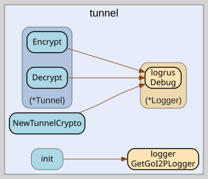

# tunnel
--
    import "github.com/go-i2p/crypto/tunnel"



Package tunnel implements I2P-specific tunnel cryptography for secure data
transmission.

Tunnels are protected in two places, and it is important not to conflate them:

  - Tunnel BUILDING (TunnelBuild / Short Tunnel Build messages) is ECIES-X25519
    with ChaCha20-Poly1305 and IS the deployed standard. The Low-level
    Cryptography spec states that "X25519 tunnel creation has replaced ElGamal
    tunnel creation", and Tunnel-Creation-ECIES (accurate for 0.9.66) specifies
    short build records implemented since release 0.9.51. See
    [BuildNoiseState] / [EncryptBuildRequest] for the key schedule, AEAD and
    reply/layer KDF primitives (record framing itself lives in go-i2p/common and
    the Noise packages, not here).
  - Tunnel LAYER encryption (the symmetric encryption of each 1028-byte tunnel
    message) is AES-256-CBC, and type 0 AES is the only layer scheme defined by
    any specification. See the "Encryption Types" section below.

# Encryption Types

AES-256-CBC (Type 0) - THE ONLY SPEC-DEFINED LAYER ENCRYPTION SCHEME:

    - Dual-layer AES-256 encryption with separate layer and IV keys
    - 1028-byte fixed-size tunnel messages (16-byte IV + 1008-byte payload)
    - CBC mode encryption with IV-based randomization
    - Required for compatibility with all current routers; the layer keys
      themselves are derived by the Tunnel-Creation-ECIES build KDF
      ([DeriveBuildReplyKeys]) rather than transmitted in the build record

Experimental ECIES-X25519 (Type 1) - NOT AN INTEROPERABLE LAYER SCHEME:

    - X25519 elliptic curve Diffie-Hellman key agreement
    - ChaCha20-Poly1305 authenticated encryption with associated data (AEAD)
    - Variable-length records: 96 bytes of overhead plus the plaintext
    - Wraps the ecies package's end-to-end one-time format

    Do not use this for real tunnels. This is not the ECIES of tunnel building
    either - it wraps the end-to-end one-time format, which no tunnel spec
    defines at any layer. Tunnel-Creation-ECIES states that "the only layer
    encryption currently supported is type 0, which is AES", and that adding
    types such as ChaCha20 "is a topic for additional research, and is not
    currently a part of this specification". Its layer-encryption-type table
    lists "1 for future (ChaCha?)" as an open question, not a format. The
    ECIES-X25519-AEAD-Ratchet spec (Proposal 144) is an end-to-end,
    destination-to-destination protocol and does not define tunnel layer
    encryption at all.

    Two claims previously made here were wrong and are corrected:

      - "218-byte tunnel records (78% smaller than AES)". The 218-byte figure is
        real, but it belongs to a different construct: it is the encrypted size
        of a *short tunnel build record* in Tunnel-Creation-ECIES (154-byte
        request plaintext, Noise_N_25519_ChaChaPoly_SHA256), not of layer
        encryption, and the 0.9.51 version requirement belongs to those build
        records too. Those build records are implemented in this package by
        [EncryptBuildRequest]. Actual output of this layer encryptor: 1-byte
        payload -> 97 bytes, 222 -> 318, 1008 -> 1104 bytes. A full tunnel
        payload therefore produces a record *larger* than AES, not 78% smaller.
      - Variable-length records also defeat the fixed-size tunnel layout, whose
        purpose is to stop intermediate hops from observing payload sizes.

Package tunnel provides I2P tunnel encryption implementations. This file
implements ECIES-X25519 tunnel encryption as a wrapper around the ecies package.

## Usage

```go
var (
	// ErrInvalidKeySize indicates that a provided key does not meet the required size.
	// AES-256 requires exactly 32-byte keys for both layer and IV encryption.
	ErrInvalidKeySize = oops.Errorf("invalid key size: must be 32 bytes for AES-256")

	// ErrCipherCreationFailed indicates that AES cipher initialization failed.
	// This typically occurs due to invalid key material or system-level cryptographic failures.
	ErrCipherCreationFailed = oops.Errorf("failed to create AES cipher block")

	// ErrNilTunnelData indicates that a nil TunnelData pointer was passed to encryption/decryption.
	// All tunnel operations require valid non-nil TunnelData structures.
	ErrNilTunnelData = oops.Errorf("tunnel data cannot be nil")

	// ErrEncryptionFailed indicates that the encryption operation failed.
	// This may occur due to invalid data, corrupted keys, or cryptographic processing errors.
	ErrEncryptionFailed = oops.Errorf("tunnel encryption failed")

	// ErrDecryptionFailed indicates that the decryption operation failed.
	// This may occur due to invalid ciphertext, incorrect keys, or authentication failures.
	ErrDecryptionFailed = oops.Errorf("tunnel decryption failed")

	// ErrUnsupportedEncryptionType indicates an unsupported tunnel encryption scheme was requested.
	// Only TunnelEncryptionAES (0) and TunnelEncryptionECIES (1) are supported.
	ErrUnsupportedEncryptionType = oops.Errorf("unsupported tunnel encryption type")

	// ErrECIESEncryptionFailed indicates that ECIES encryption operation failed.
	// This may occur due to invalid public keys, data size limits, or underlying cryptographic errors.
	ErrECIESEncryptionFailed = oops.Errorf("ECIES encryption failed")

	// ErrECIESDecryptionFailed indicates that ECIES decryption operation failed.
	// This may occur due to invalid private keys, corrupted ciphertext, or authentication failures.
	ErrECIESDecryptionFailed = oops.Errorf("ECIES decryption failed")

	// ErrECIESInvalidPublicKey indicates that an invalid X25519 public key was provided for ECIES encryption.
	// ECIES public keys must be exactly 32 bytes and contain valid curve points.
	ErrECIESInvalidPublicKey = oops.Errorf("invalid X25519 public key for ECIES encryption")

	// ErrECIESInvalidPrivateKey indicates that an invalid X25519 private key was provided for ECIES decryption.
	// ECIES private keys must be exactly 32 bytes and within the valid scalar range.
	ErrECIESInvalidPrivateKey = oops.Errorf("invalid X25519 private key for ECIES decryption")

	// ErrECIESInvalidCiphertext indicates that ECIES ciphertext has invalid format or size.
	// ECIES ciphertext must include ephemeral public key, nonce, and authenticated encryption tag.
	ErrECIESInvalidCiphertext = oops.Errorf("invalid ECIES ciphertext format")

	// ErrECIESOperationNotSupported indicates that an unsupported operation was attempted.
	// For example, trying to decrypt with an encryptor or encrypt with a decryptor.
	ErrECIESOperationNotSupported = oops.Errorf("ECIES operation not supported by this instance")
)
```
Error definitions for tunnel cryptographic operations using structured error
handling. These errors follow the oops pattern for consistent error wrapping and
context preservation.

#### type AESEncryptor

```go
type AESEncryptor struct {
}
```

AESEncryptor implements tunnel encryption using dual-layer AES-256-CBC scheme.
It maintains separate cipher blocks for layer encryption and IV encryption
operations, implementing I2P's legacy tunnel cryptography for secure data
transmission through the network. The dual-layer approach provides enhanced
security by encrypting both the data payload and the initialization vector used
for subsequent encryption operations. This implements the TunnelEncryptor
interface for AES-256-CBC encryption (type 0).

#### func  NewAESEncryptor

```go
func NewAESEncryptor(layerKey, ivKey TunnelKey) (*AESEncryptor, error)
```
NewAESEncryptor creates a new AES-256-CBC tunnel encryptor with the provided
keys. Both layerKey and ivKey must be exactly 32 bytes (256 bits) for AES-256
compatibility. The function initializes separate AES cipher blocks for
dual-layer tunnel encryption, following I2P's tunnel cryptography specification
for secure data transmission. Returns a configured AESEncryptor instance or an
error if cipher creation fails due to invalid keys. Example usage: encryptor,
err := NewAESEncryptor(layerKey, ivKey)

#### func  NewTunnelCrypto

```go
func NewTunnelCrypto(layerKey, ivKey TunnelKey) (*AESEncryptor, error)
```
NewTunnelCrypto is deprecated. Use NewAESEncryptor instead. This function is
kept for backward compatibility and will be removed in a future version.

#### func (*AESEncryptor) Decrypt

```go
func (a *AESEncryptor) Decrypt(ciphertext []byte) ([]byte, error)
```
Decrypt decrypts ciphertext data using AES-256-CBC dual-layer decryption. For
AES tunnel decryption, the input should be exactly 1028 bytes of tunnel data.
Returns the 1008-byte payload (excluding 16-byte IV) or error if decryption
fails. This implements the TunnelEncryptor interface for AES-256-CBC decryption.

#### func (*AESEncryptor) Encrypt

```go
func (a *AESEncryptor) Encrypt(plaintext []byte) ([]byte, error)
```
Encrypt encrypts plaintext data using AES-256-CBC dual-layer encryption. For AES
tunnel encryption, the input should be exactly 1008 bytes of payload data. The
method creates a 1028-byte tunnel structure with a 16-byte IV prefix. Returns
the complete tunnel data (1028 bytes) or error if encryption fails. This
implements the TunnelEncryptor interface for AES-256-CBC encryption.

#### func (*AESEncryptor) Type

```go
func (a *AESEncryptor) Type() TunnelEncryptionType
```
Type returns the encryption scheme used by this encryptor (AES-256-CBC). This
implements the TunnelEncryptor interface Type() method.

#### type ECIESDecryptor

```go
type ECIESDecryptor struct {
}
```

ECIESDecryptor implements TunnelEncryptor using ECIES-X25519 decryption. This is
a separate struct because decryption requires a private key.

#### func  NewECIESDecryptor

```go
func NewECIESDecryptor(recipientPrivKey [32]byte) *ECIESDecryptor
```
NewECIESDecryptor creates a new ECIES tunnel decryptor using the recipient's
private key. The private key must be exactly 32 bytes (X25519 private key
format).

#### func (*ECIESDecryptor) Decrypt

```go
func (d *ECIESDecryptor) Decrypt(ciphertext []byte) ([]byte, error)
```
Decrypt decrypts the ciphertext using ECIES-X25519 scheme with the private key.
This method wraps ecies.DecryptECIESX25519() and delegates all cryptographic
operations to the existing ecies package.

#### func (*ECIESDecryptor) Encrypt

```go
func (d *ECIESDecryptor) Encrypt(plaintext []byte) ([]byte, error)
```
Encrypt is not supported by the decryptor. Returns an error.

#### func (*ECIESDecryptor) Type

```go
func (d *ECIESDecryptor) Type() TunnelEncryptionType
```
Type returns the tunnel encryption type for this decryptor.

#### func (*ECIESDecryptor) Zero

```go
func (d *ECIESDecryptor) Zero()
```
Zero securely clears the private key from memory.

#### type ECIESEncryptor

```go
type ECIESEncryptor struct {
}
```

ECIESEncryptor implements TunnelEncryptor using ECIES-X25519 encryption. This is
a thin wrapper around the existing ecies package functionality.

EXPERIMENTAL - NOT INTEROPERABLE. No I2P specification defines this as a tunnel
layer encryption scheme. The ecies package's one-time format is an end-to-end
(destination-to-destination) construct; Tunnel-Creation-ECIES, which does govern
tunnel layer encryption, supports only AES (type 0) and explicitly leaves any
ChaCha20-based type out of scope. Records produced here are variable length,
which also conflicts with the fixed-size tunnel record layout. Use AESEncryptor
for real tunnels.

#### func  NewECIESEncryptor

```go
func NewECIESEncryptor(recipientPubKey [32]byte) *ECIESEncryptor
```
NewECIESEncryptor creates a new ECIES tunnel encryptor using the recipient's
public key. The public key must be exactly 32 bytes (X25519 public key format).
This encryptor will generate ephemeral keys for each encryption operation.

#### func (*ECIESEncryptor) Decrypt

```go
func (e *ECIESEncryptor) Decrypt(ciphertext []byte) ([]byte, error)
```
Decrypt decrypts the ciphertext using ECIES-X25519 scheme. This method wraps
ecies.DecryptECIESX25519() and delegates all cryptographic operations to the
existing ecies package.

Note: For tunnel decryption, this requires the recipient's private key. In a
real tunnel implementation, each hop would have its own private key for
decrypting its layer of encryption.

Expected ciphertext format: [ephemeral_pubkey][nonce][aead_ciphertext]

#### func (*ECIESEncryptor) Encrypt

```go
func (e *ECIESEncryptor) Encrypt(plaintext []byte) ([]byte, error)
```
Encrypt encrypts the plaintext using ECIES-X25519 scheme. This method wraps
ecies.EncryptECIESX25519() and delegates all cryptographic operations to the
existing ecies package.

The encryption uses the ecies package's one-time (end-to-end) format: - Generates
ephemeral X25519 key pair - Performs X25519 key agreement with recipient's public
key - Derives encryption key with the Noise-based key schedule (see ecies) -
Encrypts using ChaCha20-Poly1305 AEAD

Returns ciphertext in the one-time format: [Elligator2-encoded ephemeral public
key 32][flags section 48][payload section N+16] - 96 bytes of overhead plus the
plaintext, so the output is variable length and is not a 1028-byte tunnel record.

#### func (*ECIESEncryptor) Type

```go
func (e *ECIESEncryptor) Type() TunnelEncryptionType
```

#### type TunnelData

```go
type TunnelData [1028]byte
```

TunnelData represents the standardized data structure for I2P tunnel messages
(1028 bytes total). The structure follows I2P's tunnel message format where the
first 16 bytes serve as the initialization vector (IV) and the remaining 1008
bytes contain the encrypted payload data. This fixed-size format ensures network
compatibility and provides consistent message boundaries for tunnel encryption
operations. The 1028-byte size aligns with I2P's network protocol requirements
for efficient data transmission. TunnelData represents the data structure for
tunnel messages (1028 bytes). Moved from: tunnel.go

#### type TunnelEncryptionType

```go
type TunnelEncryptionType uint8
```

TunnelEncryptionType distinguishes between different tunnel encryption schemes.
I2P's specifications define only AES (type 0) for tunnel layer encryption. Use
TunnelEncryptionAES for anything that has to talk to a real router;
TunnelEncryptionECIES is experimental and not interoperable.

```go
const (
	// TunnelEncryptionAES is the AES-256-CBC tunnel layer encryption scheme,
	// and the only layer encryption type defined by the I2P specifications.
	// Tunnel records are 1028 bytes with 16-byte IV and 1008-byte encrypted payload.
	TunnelEncryptionAES TunnelEncryptionType = 0

	// TunnelEncryptionECIES is EXPERIMENTAL and NOT interoperable. No I2P
	// specification defines an ECIES/ChaCha20 tunnel layer encryption type.
	// Records are variable length: 96 bytes of overhead plus the plaintext
	// (e.g. a 1008-byte payload produces a 1104-byte record, larger than AES).
	TunnelEncryptionECIES TunnelEncryptionType = 1
)
```

#### func (TunnelEncryptionType) String

```go
func (t TunnelEncryptionType) String() string
```
String returns the human-readable name of the encryption type for logging and
debugging.

#### type TunnelEncryptor

```go
type TunnelEncryptor interface {
	// Encrypt encrypts plaintext data and returns the ciphertext.
	// For AES: expects 1008 bytes of payload data, returns 1028 bytes (with 16-byte IV prefix)
	// For ECIES: accepts variable-length data up to max size, returns ECIES format
	// Returns error if encryption fails due to invalid keys or cryptographic operations.
	Encrypt(plaintext []byte) ([]byte, error)

	// Decrypt decrypts ciphertext data and returns the plaintext.
	// For AES: expects 1028 bytes of tunnel data, returns 1008 bytes of payload
	// For ECIES: expects ECIES-formatted ciphertext, returns original plaintext
	// Returns error if decryption fails due to invalid keys, corrupted data, or authentication failures.
	Decrypt(ciphertext []byte) ([]byte, error)

	// Type returns the encryption scheme used by this encryptor.
	// This enables routers to identify and handle different tunnel encryption formats.
	Type() TunnelEncryptionType
}
```

TunnelEncryptor defines the interface for tunnel-level encryption operations.
The abstraction has two implementations: AES-256-CBC, the scheme the I2P
specifications define for tunnel layer encryption, and ECIES-X25519, which is
experimental and not interoperable (see TunnelEncryptionECIES). Only the AES
implementation follows an I2P protocol specification.

#### func  NewTunnelEncryptor

```go
func NewTunnelEncryptor(encType TunnelEncryptionType, layerKey, ivKey TunnelKey) (TunnelEncryptor, error)
```
NewTunnelEncryptor creates a new tunnel encryptor based on the specified
encryption type. This factory function provides a unified interface for creating
both AES and ECIES encryptors.

For AES encryption (type 0):

    - layerKey: 32-byte AES-256 key for data layer encryption
    - ivKey: 32-byte AES-256 key for IV encryption

For ECIES encryption (type 1):

    - recipientPubKey: 32-byte X25519 public key (layerKey parameter)
    - ivKey parameter is ignored for ECIES

Returns configured TunnelEncryptor or error if creation fails due to invalid
parameters.

#### type TunnelIV

```go
type TunnelIV []byte
```

TunnelIV represents the initialization vector for tunnel message encryption
operations. The IV provides randomization for CBC mode encryption and should be
unique for each tunnel message to prevent cryptographic attacks. In I2P tunnel
messages, the IV occupies the first 16 bytes of the TunnelData structure and
serves as the randomization source for CBC encryption. IVs must be unpredictable
but do not need to be secret, following standard cryptographic practices.
TunnelIV represents the initialization vector for a tunnel message. Moved from:
tunnel.go

#### type TunnelKey

```go
type TunnelKey [32]byte
```

TunnelKey represents a symmetric AES-256 key for encrypting tunnel messages (32
bytes). Each tunnel operation requires two separate TunnelKey instances: one for
layer encryption and another for IV encryption. The 32-byte length provides
256-bit security strength compatible with AES-256 encryption used in I2P tunnel
cryptography. These keys should be cryptographically random and generated using
secure random number generators. TunnelKey represents a symmetric key for
encrypting tunnel messages (32 bytes). Moved from: tunnel.go


tunnel 

github.com/go-i2p/crypto/tunnel

[go-i2p template file](/template.md)
